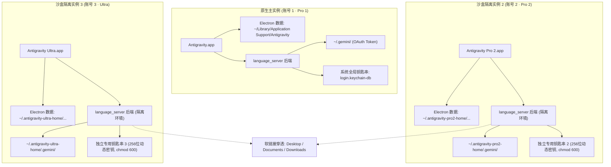

<p align="center">
  
</p>

<h1 align="center">Antigravity TwoUsers</h1>

<p align="center">
  <b>macOS 专属 Google Antigravity 双开 / 三开全物理沙盒管理器（Pro 1 · Pro 2 · Ultra）</b><br>
  告别 5 小时速率限制，实现多账号零串号、256 位动态密钥守护、多窗口同时在线开发。
</p>

<p align="center">
  <b>简体中文</b> ·
  <a href="docs/README.en.md">English</a> ·
  <a href="docs/README.ja.md">日本語</a> ·
  <a href="docs/README.ko.md">한국어</a> ·
  <a href="docs/README.es.md">Español</a> ·
  <a href="docs/README.fr.md">Français</a> ·
  <a href="docs/README.pt.md">Português</a>
</p>

<p align="center">
  <a href="https://apple.com"></a>
  
  
  
  <a href="LICENSE"></a>
</p>

<p align="center">
  <a href="#-核心亮点">✨ 核心亮点</a> •
  <a href="#-方案对比">⚖️ 方案对比</a> •
  <a href="#-物理沙盒隔离架构">🏗️ 技术架构</a> •
  <a href="#-快速安装">🚀 快速安装</a> •
  <a href="#-多-agent-黄金接力工作流">🔄 接力工作流</a> •
  <a href="#-安全与隐私保障">🛡️ 安全机制</a> •
  <a href="#-常见问题-faq">❓ FAQ</a>
</p>

---

## ✨ 核心亮点

<table>
  <tr>
    <td width="33%" valign="top">
      <h3>🧊 100% 物理沙盒隔离</h3>
      同时重定向 <code>$HOME</code> 与 Electron <code>--user-data-dir</code>，前端缓存与 Go 后端 <code>language_server</code> 彻底分离，永不串号。
    </td>
    <td width="33%" valign="top">
      <h3>🔐 256 位动态加密密钥</h3>
      安装时通过 <code>openssl rand -hex 32</code> 为每个实例生成独一无二的 256 位随机钥匙串密码，<code>chmod 600</code> 严格保护，代码零硬编码。
    </td>
    <td width="33%" valign="top">
      <h3>♾️ 后台无感自动续期</h3>
      彻底根治命令行钥匙串 5 分钟自动锁定导致的 1 小时后 OAuth 失效问题，全天候稳定在线、模型不掉线。
    </td>
  </tr>
  <tr>
    <td width="33%" valign="top">
      <h3>🚀 支持双开与三开</h3>
      内置 <b>Pro 2</b> 与 <b>Ultra（第 3 实例）</b>一键脚本，原生支持 3 个独立窗口并排运行，各自独立消耗额度。
    </td>
    <td width="33%" valign="top">
      <h3>🖥️ 原生 Dock 图标集成</h3>
      自动编译原生 macOS <code>.app</code> 启动器并精准插入程序坞（Dock），同时软链接桌面/文档/下载目录，秒开本地代码库。
    </td>
    <td width="33%" valign="top">
      <h3>🧹 无侵入、一键还原</h3>
      共享官方主程序二进制文件不占额外体积，绝不修改宿主系统默认钥匙串，卸载后原版 Antigravity 100% 保持原样。
    </td>
  </tr>
</table>

---

## ⚖️ 方案对比

| 特性对比 | 原生单账号 | 仅改 `--user-data-dir` | **Antigravity TwoUsers (本项目)** |
| :--- | :---: | :---: | :---: |
| 多账号同时在线（双开 / 三开） | ❌ | ❌（后端自动串号） | ✅ **完全支持（Pro 1 + Pro 2 + Ultra）** |
| 切换账号免登出 / 免重新授权 | ❌ | ❌ | ✅ **各自永久保持独立登录态** |
| OAuth 令牌后台自动刷新（不掉线） | ✅ | ❌（钥匙串锁定报错） | ✅ **禁用超时锁死，24h 稳定续期** |
| 密码安全（无硬编码明文密码） | ✅ | — | ✅ **本机 256 位随机密钥 + `chmod 600`** |
| 不污染宿主系统默认钥匙串 | ✅ | ⚠️ | ✅ **仅在独立子进程沙盒内生效** |
| 无缝访问桌面与本地 Git 仓库 | ✅ | ✅ | ✅ **自动软链接 Desktop / Documents / Downloads** |

---

## 🏗️ 物理沙盒隔离架构

<p align="center">
  
</p>

<details>
<summary><b>📐 点击展开 Mermaid 底层进程与数据流向图</b></summary>



</details>

### 🔬 攻克的 3 大底层技术难题

1. **解决“仅改 `--user-data-dir` 导致自动串号”**：Antigravity 由 Electron 前端与 Go `language_server` 后端组成。后端服务直接读取 `$HOME/.gemini/` 与 Keychain；本项目在独立子进程中同步重定向 `$HOME` 与 `--user-data-dir`，彻底切断账号串流。
2. **解决“多实例 OAuth 网页回调冲突”**：Antigravity 登录依赖本地临时 Loopback HTTP 端口接收授权回调。每个分身在独立上下文中监听专属端口，避免出现 *"Further action is required"* 冲突。
3. **解决“运行数小时后模型变灰 / 提示无额度”**：Google OAuth `access_token` 有效期为 1 小时，过期后需读取 Keychain 中的 `refresh_token` 自动续期。macOS 命令行创建的钥匙串默认开启 **300 秒无操作自动锁死** 与 **休眠锁死**；本项目通过 `security set-keychain-settings` 解除超时锁死，并配合本机 256 位随机密钥实现无感续期。

---

## 🚀 快速安装

### 前置要求
* macOS 14+（支持 Apple Silicon M1–M4 与 Intel Mac）
* 已在 `/Applications/Antigravity.app` 安装官方 Google Antigravity 客户端

### 1. 克隆项目
```bash
git clone https://github.com/Kongxijun88/antigravity-twousers.git
cd antigravity-twousers
```

### 2. 一键安装第 2 实例（`Antigravity Pro 2`）
```bash
chmod +x install.sh
./install.sh
```

### 3. 一键安装第 3 实例（`Antigravity Ultra`，可选）
```bash
chmod +x install-ultra.sh
./install-ultra.sh
```

### 📋 实例布局总览

| 实例名称 | 启动方式（Dock / 应用程序） | 隔离沙盒目录 | 命令行调试脚本 |
| :--- | :--- | :--- | :--- |
| **主实例 (Pro 1)** | `/Applications/Antigravity.app` | `~/.gemini/`（系统默认） | — |
| **实例 2 (Pro 2)** | `/Applications/Antigravity Pro 2.app` | `~/.antigravity-pro2-home/` | `./scripts/launch.sh` |
| **实例 3 (Ultra)** | `/Applications/Antigravity Ultra.app` | `~/.antigravity-ultra-home/` | `./scripts/launch-ultra.sh` |

> 首次点击程序坞中的 **`Antigravity Pro 2`** 或 **`Antigravity Ultra`**，窗口将以完全纯净的未登录状态启动，直接登录对应的 Google Pro / Ultra 账号即可永久保存状态。

---

## 📂 项目结构

```text
antigravity-twousers/
├── install.sh                 # 一键安装实例 2 (Antigravity Pro 2)
├── uninstall.sh               # 一键安全卸载实例 2
├── install-ultra.sh           # 一键安装实例 3 (Antigravity Ultra)
├── uninstall-ultra.sh         # 一键安全卸载实例 3
├── scripts/
│   ├── launch.sh              # 实例 2 命令行独立启动器（支持传参调试）
│   └── launch-ultra.sh        # 实例 3 命令行独立启动器（支持传参调试）
├── assets/
│   ├── banner.png             # 项目视觉横幅
│   └── architecture.png       # 物理沙盒隔离架构图
├── docs/                      # 多语言文档 (EN / JA / KO / ES / FR / PT)
└── LICENSE                    # MIT 开源协议
```

---

## 🔄 多 Agent 黄金接力工作流

拥有多个账号（如 **2 个 Pro + 1 个 Ultra**）时，推荐使用**任务分级 + 上下文无损接力协议（Relay Protocol）**，实现 24 小时不间断开发：

| 账号分工 | 推荐场景 |
| :--- | :--- |
| **Antigravity (Pro 1)** | 日常功能开发、页面微调、单元测试与常规 Bug 修复 |
| **Antigravity Pro 2** | Pro 1 触发 5 小时速率限制时的无缝接力替补 |
| **Antigravity Ultra** | 复杂系统架构重构、高难度全栈排障与重度推理任务 |

### 两步无损交接协议

**第一步：当前账号额度见底前（存档交棒）**
```text
我马上要切换到另一个账号接手这个项目。请帮我把目前的代码修改全部保存并做一次 git commit 存档；在根目录生成 HANDOVER.md 记录已完成事项、关键设计与下一步待办清单；并写一段简短的交接提示词，方便我直接发给下一个 Agent 无缝接手。
```

**第二步：切换至下一个实例（读档接棒）**
在 **Antigravity Pro 2** 或 **Antigravity Ultra** 中通过 `File -> Open Folder` 打开同一项目目录，发送交接提示词：
```text
请阅读项目根目录的 HANDOVER.md 和最新 git commit，掌握当前进度后，继续完成下一步待办任务。
```

---

## 🛡️ 安全与隐私保障

| 安全维度 | 实现方式 |
| :--- | :--- |
| **零硬编码密码** | 代码与 Git 历史中绝无写死密码，每次安装现场调用 `openssl rand -hex 32` 生成独立 256 位随机密钥 |
| **文件权限隔离** | 密钥文件 `.keychain_secret` 与钥匙串数据库 `login.keychain-db` 均强制设置为 `chmod 600`（仅限本机当前用户读写） |
| **宿主零污染** | 启动器仅在子进程中通过 `export HOME` 隔离环境，**绝不修改** macOS 宿主用户的默认登录钥匙串 |
| **零遥测 / 纯本地** | 全部脚本均为透明可读的开源 Bash / Python 代码，无任何网络上传或外部依赖 |

---

## 🗑️ 安全卸载

```bash
# 卸载实例 2 (Antigravity Pro 2)
./uninstall.sh

# 卸载实例 3 (Antigravity Ultra)
./uninstall-ultra.sh
```

卸载脚本将自动终止对应分身进程、移除 `/Applications` 内的 `.app` 与程序坞图标，并询问是否彻底销毁对应的沙盒目录与专属钥匙串（若保留数据，将自动对钥匙串执行上锁保护）。**原版 Antigravity 与主账号 100% 不受任何影响。**

---

## ❓ 常见问题 (FAQ)

<details>
<summary><b>Q1: 为什么在分身实例中可以直接打开桌面和下载目录的项目？</b></summary>
<br>
安装脚本在每个沙盒目录中自动创建了指向 <code>~/Desktop</code>、<code>~/Documents</code> 与 <code>~/Downloads</code> 的软链接，确保你可以像原版一样零障碍访问所有本地代码仓库。
</details>

<details>
<summary><b>Q2: Mac 重启后会不会串号或需要重新登录？</b></summary>
<br>
<b>绝对不会。</b> 每个实例的 OAuth 凭据分别固化在各自的沙盒目录与独立钥匙串中，重启电脑后各自读取独立保险箱，互不干扰。
</details>

<details>
<summary><b>Q3: 3 个实例同时运行，Mac 内存和性能吃得消吗？</b></summary>
<br>
<b>非常轻松。</b> 三个实例共享同一份官方客户端二进制文件，几乎不额外占用硬盘空间；每个实例运行内存约 500MB–800MB，3 开总计约 2GB–2.5GB，16GB 及以上内存的 Apple Silicon Mac 可全天候流畅并行。
</details>

<details>
<summary><b>Q4: 多个实例可以同时打开同一个 Git 项目文件夹吗？</b></summary>
<br>
<b>可以。</b> 代码文件位于真实的本地磁盘中。建议搭配上文的【多 Agent 黄金接力工作流】交替操作，避免两个 AI Agent 同时写入同一文件造成未保存冲突。
</details>

<details>
<summary><b>Q5: 扩展插件、主题与快捷键配置是共享还是独立的？</b></summary>
<br>
<b>完全独立。</b> 每个实例拥有专属的插件目录与偏好设置，你可以为主力账号、备用账号与 Ultra 账号定制不同的主题颜色（强烈建议设置不同主题色，肉眼一眼区分窗口！）。
</details>

---

## 📄 License

本项目基于 [MIT License](LICENSE) 开源。如果这个项目帮到了你，欢迎点一颗 **Star ⭐️** 支持！
