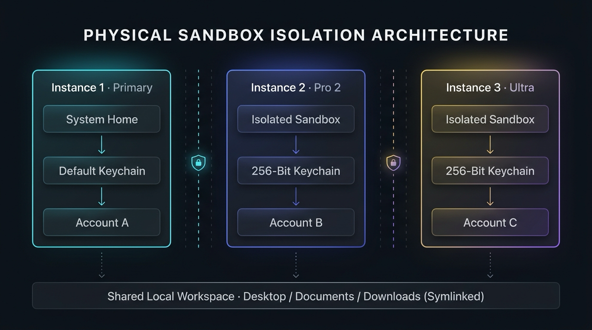
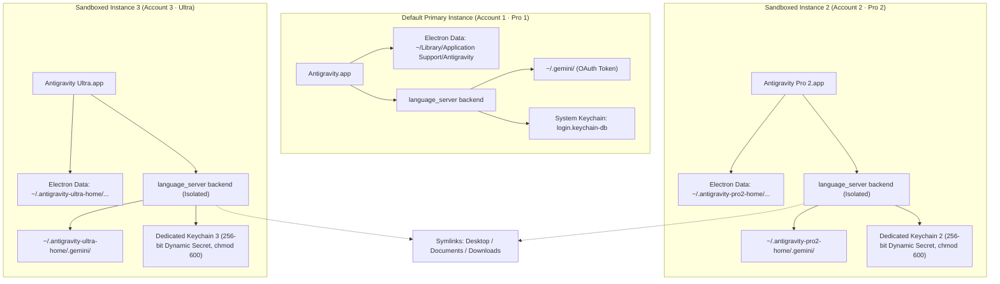

<p align="center">
  
</p>

<h1 align="center">Antigravity TwoUsers</h1>

<p align="center">
  <b>Sandboxed Dual &amp; Triple Instance Manager for Google Antigravity on macOS (Pro 1 · Pro 2 · Ultra)</b><br>
  Bypass 5-hour rate limits with zero account crosstalk, 256-bit dynamic Keychain protection, and concurrent multi-window workflows.
</p>

<p align="center">
  <a href="../README.md">简体中文</a> ·
  <b>English</b> ·
  <a href="README.ja.md">日本語</a> ·
  <a href="README.ko.md">한국어</a> ·
  <a href="README.es.md">Español</a> ·
  <a href="README.fr.md">Français</a> ·
  <a href="README.pt.md">Português</a>
</p>

<p align="center">
  <a href="https://apple.com"></a>
  
  
  
  <a href="../LICENSE"></a>
</p>

<p align="center">
  <a href="#-key-highlights">✨ Highlights</a> •
  <a href="#-comparison">⚖️ Comparison</a> •
  <a href="#-physical-sandbox-architecture">🏗️ Architecture</a> •
  <a href="#-quick-start">🚀 Quick Start</a> •
  <a href="#-multi-agent-relay-protocol">🔄 Relay Protocol</a> •
  <a href="#-security--privacy">🛡️ Security</a> •
  <a href="#-faq">❓ FAQ</a>
</p>

---

## ✨ Key Highlights

<table>
  <tr>
    <td width="33%" valign="top">
      <h3>🧊 100% Physical Sandbox</h3>
      Redirects both <code>$HOME</code> and Electron <code>--user-data-dir</code>, completely isolating the UI cache and Go <code>language_server</code> backend with zero crosstalk.
    </td>
    <td width="33%" valign="top">
      <h3>🔐 256-Bit Dynamic Keychain</h3>
      Generates a unique per-install 256-bit cryptographic secret via <code>openssl rand -hex 32</code> stored with <code>chmod 600</code>. Zero hardcoded passwords.
    </td>
    <td width="33%" valign="top">
      <h3>♾️ Silent Token Auto-Refresh</h3>
      Eliminates macOS CLI Keychain's 5-minute idle auto-lock so hourly Google OAuth refreshes succeed reliably 24/7.
    </td>
  </tr>
  <tr>
    <td width="33%" valign="top">
      <h3>🚀 Dual &amp; Triple Instances</h3>
      One-click installers for both <b>Antigravity Pro 2</b> and <b>Antigravity Ultra</b>—run up to 3 independent accounts side-by-side.
    </td>
    <td width="33%" valign="top">
      <h3>🖥️ Native Dock Integration</h3>
      Compiles native macOS <code>.app</code> launchers with official icons pinned right to your Dock, plus symlinks to Desktop, Documents, and Downloads.
    </td>
    <td width="33%" valign="top">
      <h3>🧹 Zero-Footprint &amp; Reversible</h3>
      Shares the single official app binary, never modifies your host default Keychain, and leaves your primary Antigravity 100% untouched on uninstall.
    </td>
  </tr>
</table>

---

## ⚖️ Comparison

| Feature | Native Single App | `--user-data-dir` Only | **Antigravity TwoUsers** |
| :--- | :---: | :---: | :---: |
| Concurrent multi-account windows (2x / 3x) | ❌ | ❌ (Backend collides) | ✅ **Pro 1 + Pro 2 + Ultra** |
| Switch accounts without re-authenticating | ❌ | ❌ | ✅ **Persistent isolated sessions** |
| Continuous background OAuth token refresh | ✅ | ❌ (Keychain locks) | ✅ **No-timeout refresh, 24/7 uptime** |
| Zero hardcoded credentials | ✅ | — | ✅ **256-bit random secret (`chmod 600`)** |
| Host default macOS Keychain untouched | ✅ | ⚠️ | ✅ **Subprocess-scoped isolation only** |
| Direct access to Desktop &amp; local Git repos | ✅ | ✅ | ✅ **Auto-symlinked workspace folders** |

---

## 🏗️ Physical Sandbox Architecture

<p align="center">
  
</p>

<details>
<summary><b>📐 Expand Mermaid Process &amp; Data Flow Diagram</b></summary>



</details>

### 🔬 3 Core Engineering Pitfalls Solved

1. **Preventing Session Crosstalk**: `--user-data-dir` only moves Electron's cache while the Go `language_server` still reads `$HOME/.gemini/` and Keychain. Wrapping each instance with both a custom `$HOME` and `--user-data-dir` completely isolates both layers.
2. **Clean OAuth Loopback Binding**: Antigravity captures Google OAuth redirects via an ephemeral local loopback HTTP port. Each sandboxed instance binds its own clean context, eliminating *"Further action is required"* callback collisions.
3. **Eliminating Hourly Model Dropouts**: Google OAuth access tokens expire every 60 minutes. CLI-created macOS keychains default to a **300-second idle lock** and **sleep lock**, silently breaking background token refreshes. Applying `security set-keychain-settings` with a unique `chmod 600` 256-bit secret ensures rock-solid 24/7 operation.

---

## 🚀 Quick Start

### Prerequisites
* macOS 14+ (Apple Silicon M1–M4 or Intel)
* Official Google Antigravity installed at `/Applications/Antigravity.app`

### 1. Clone the Repository
```bash
git clone https://github.com/Kongxijun88/antigravity-twousers.git
cd antigravity-twousers
```

### 2. Install Instance 2 (`Antigravity Pro 2`)
```bash
chmod +x install.sh
./install.sh
```

### 3. Install Instance 3 (`Antigravity Ultra`, Optional)
```bash
chmod +x install-ultra.sh
./install-ultra.sh
```

### 📋 Instance Directory Overview

| Instance | App Launcher (Dock / Applications) | Isolated Sandbox Home | CLI Debug Runner |
| :--- | :--- | :--- | :--- |
| **Primary (Pro 1)** | `/Applications/Antigravity.app` | `~/.gemini/` (System default) | — |
| **Instance 2 (Pro 2)** | `/Applications/Antigravity Pro 2.app` | `~/.antigravity-pro2-home/` | `./scripts/launch.sh` |
| **Instance 3 (Ultra)** | `/Applications/Antigravity Ultra.app` | `~/.antigravity-ultra-home/` | `./scripts/launch-ultra.sh` |

---

## 📂 Project Structure

```text
antigravity-twousers/
├── install.sh                 # One-click installer for Instance 2 (Pro 2)
├── uninstall.sh               # Clean uninstaller for Instance 2
├── install-ultra.sh           # One-click installer for Instance 3 (Ultra)
├── uninstall-ultra.sh         # Clean uninstaller for Instance 3
├── scripts/
│   ├── launch.sh              # Standalone CLI runner for Instance 2
│   └── launch-ultra.sh        # Standalone CLI runner for Instance 3
├── assets/
│   ├── banner.png             # Repository hero cover
│   └── architecture.png       # Sandbox isolation architecture infographic
├── docs/                      # Localized READMEs (EN / JA / KO / ES / FR / PT)
└── LICENSE                    # MIT License
```

---

## 🔄 Multi-Agent Relay Protocol

Maximize multiple accounts (**2× Pro + 1× Ultra**) using **Tiered Routing + Context-Preserving Handover**:

| Instance | Recommended Role |
| :--- | :--- |
| **Antigravity (Pro 1)** | Daily feature work, UI polish, unit tests, and routine fixes |
| **Antigravity Pro 2** | Seamless relay backup whenever Pro 1 hits its 5-hour quota |
| **Antigravity Ultra** | Complex architecture refactors, deep debugging, and heavy reasoning |

### 2-Step Seamless Handover

**Step 1 — Save & Hand Off (Active Window):**
```text
I will shortly switch to another account to continue this project. Please save all changes, create a clean git commit checkpoint, write a HANDOVER.md summarizing completed work, key decisions, and next tasks, and provide a brief handoff prompt I can paste to the next agent.
```

**Step 2 — Resume Instantly (Next / Ultra Window):**
Open the same repository via `File -> Open Folder` in **Antigravity Pro 2** or **Antigravity Ultra** and paste:
```text
Please read HANDOVER.md and the latest git commit to understand current project state, then continue with the next pending task.
```

---

## 🛡️ Security & Privacy

| Control | Implementation |
| :--- | :--- |
| **Zero Hardcoded Passwords** | Each installation generates a fresh 256-bit cryptographic password locally via `openssl rand -hex 32` |
| **Strict File Permissions** | Both `.keychain_secret` and `login.keychain-db` are locked down to `chmod 600` (owner read/write only) |
| **Host Keychain Untouched** | Subprocess `export HOME` isolates macOS Keychain routing without mutating your system default Keychain |
| **100% Local & Auditable** | Pure transparent Bash & Python scripts with zero telemetry or external network calls |

---

## 🗑️ Clean Uninstallation

```bash
# Uninstall Instance 2 (Antigravity Pro 2)
./uninstall.sh

# Uninstall Instance 3 (Antigravity Ultra)
./uninstall-ultra.sh
```

Each uninstaller terminates running processes for that instance, removes its `.app` and Dock tile, and asks whether to purge or retain (and lock) its isolated sandbox data. **Your original Antigravity app and primary account remain 100% intact.**

---

## ❓ FAQ

<details>
<summary><b>Q1: Can the extra instances access files on my Desktop or Downloads?</b></summary>
<br>
Yes. Each sandbox automatically symlinks <code>~/Desktop</code>, <code>~/Documents</code>, and <code>~/Downloads</code> so you can open any local repository effortlessly.
</details>

<details>
<summary><b>Q2: Will rebooting macOS mix up accounts or sign me out?</b></summary>
<br>
<b>Never.</b> Each instance stores its credentials strictly inside its own isolated home directory and dedicated Keychain.
</details>

<details>
<summary><b>Q3: Can my Mac run all 3 instances smoothly at the same time?</b></summary>
<br>
<b>Yes.</b> All instances share one single app binary on disk. Running memory is ~500MB–800MB per instance (~2GB–2.5GB total for 3 instances), which runs smoothly on any 16GB+ Apple Silicon Mac.
</details>

<details>
<summary><b>Q4: Can multiple instances open the same Git folder concurrently?</b></summary>
<br>
<b>Yes.</b> Files live on your standard local filesystem. Follow the Multi-Agent Relay Protocol above so two agents don't edit the same uncommitted file simultaneously.
</details>

<details>
<summary><b>Q5: Are extensions, themes, and settings shared or independent?</b></summary>
<br>
<b>Completely independent.</b> Tip: Give each instance a distinct color theme so you can tell Pro 1, Pro 2, and Ultra apart at a glance!
</details>

---

## 📄 License

Licensed under the [MIT License](../LICENSE). If you find this project helpful, consider giving it a **Star ⭐️**!
