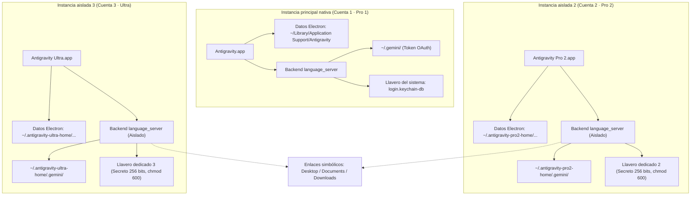

<p align="center">
  
</p>

<h1 align="center">Antigravity TwoUsers</h1>

<p align="center">
  <b>Gestor de Instancias Duales y Triples con Sandbox Físico para Google Antigravity en macOS (Pro 1 · Pro 2 · Ultra)</b><br>
  Supera los límites de 5 horas · Llavero Dinámico de 256 Bits · Enrutador Inteligente de Callbacks OAuth · Ejecución Paralela
</p>

<p align="center">
  <a href="../README.md">简体中文</a> ·
  <a href="README.en.md">English</a> ·
  <a href="README.ja.md">日本語</a> ·
  <a href="README.ko.md">한국어</a> ·
  <b>Español</b> ·
  <a href="README.fr.md">Français</a> ·
  <a href="README.pt.md">Português</a>
</p>

<p align="center">
  <a href="https://apple.com"></a>
  
  
  
  
  <a href="../LICENSE"></a>
</p>

<p align="center">
  <a href="#-aspectos-destacados">✨ Destacados</a> •
  <a href="#-comparativa">⚖️ Comparativa</a> •
  <a href="#-arquitectura-de-sandbox-físico">🏗️ Arquitectura</a> •
  <a href="#-enrutador-inteligente-de-callbacks-oauth">🧭 Enrutador OAuth</a> •
  <a href="#-instalación-rápida">🚀 Instalación</a> •
  <a href="#-protocolo-de-relevo-multi-agente">🔄 Protocolo de Relevo</a> •
  <a href="#-seguridad-y-privacidad">🛡️ Seguridad</a> •
  <a href="#-preguntas-frecuentes-faq">❓ FAQ</a>
</p>

---

## ✨ Aspectos Destacados

<table>
  <tr>
    <td width="33%" valign="top">
      <h3>🧊 Sandbox Físico 100% Aislado</h3>
      Redirige tanto <code>$HOME</code> como <code>--user-data-dir</code> de Electron, separando por completo la caché de interfaz y el backend Go <code>language_server</code>.
    </td>
    <td width="33%" valign="top">
      <h3>🧭 Enrutador Inteligente OAuth</h3>
      <b>Antigravity Router</b> en Swift nativo intercepta <code>antigravity://</code> tras autorizar en el navegador y vuelve exactamente a la ventana Pro 2 / Ultra que inició sesión.
    </td>
    <td width="33%" valign="top">
      <h3>🔐 Llavero Dinámico de 256 Bits</h3>
      Genera localmente una clave criptográfica única mediante <code>openssl rand -hex 32</code> con permisos <code>chmod 600</code>. Cero contraseñas fijas.
    </td>
  </tr>
  <tr>
    <td width="33%" valign="top">
      <h3>♾️ Renovación Silenciosa 24/7</h3>
      Elimina el bloqueo de 5 minutos del Llavero CLI de macOS para que las renovaciones OAuth cada hora nunca fallen.
    </td>
    <td width="33%" valign="top">
      <h3>🚀 Instancias Duales y Triples</h3>
      Instaladores en un clic para <b>Pro 2</b> y <b>Ultra (Instancia 3)</b> con integración nativa en el Dock y enlaces simbólicos automáticos.
    </td>
    <td width="33%" valign="top">
      <h3>🧹 Cero Intrusión y Reversible</h3>
      Comparte el binario oficial sin duplicar disco, nunca altera tu Llavero principal y deja la app original 100% intacta al desinstalar.
    </td>
  </tr>
</table>

---

## ⚖️ Comparativa

| Característica | App Nativa Única | Solo `--user-data-dir` | **Antigravity TwoUsers** |
| :--- | :---: | :---: | :---: |
| Ventanas paralelas multi-cuenta (2× / 3×) | ❌ | ❌ (Colisión en backend) | ✅ **Pro 1 + Pro 2 + Ultra** |
| "Abrir Antigravity" vuelve a la instancia exacta | — | ❌ (Siempre abre Principal) | ✅ **Enrutador URL nativo en Swift** |
| Cambiar de cuenta sin cerrar sesión | ❌ | ❌ | ✅ **Sesiones aisladas permanentes** |
| Renovación automática de tokens OAuth | ✅ | ❌ (Llavero bloqueado) | ✅ **Sin tiempo límite, estable 24/7** |
| Sin contraseñas escritas en código | ✅ | — | ✅ **Secreto 256 bits (`chmod 600`)** |
| Llavero principal del sistema intacto | ✅ | ⚠️ | ✅ **Aislamiento por subproceso** |

---

## 🏗️ Arquitectura de Sandbox Físico

<p align="center">
  
</p>

<details>
<summary><b>📐 Desplegar Diagrama Mermaid de Procesos y Flujo de Datos</b></summary>



</details>

---

## 🧭 Enrutador Inteligente de Callbacks OAuth

<p align="center">
  
</p>

En macOS, `antigravity://` se asocia por defecto únicamente a la aplicación principal. Nuestra app nativa en Swift **`Antigravity Router.app`** (0 MB en reposo) resuelve esto con **Enrutamiento de Doble Señal**:
1. **Señal 1 · Marca temporal de autenticación**: Detecta qué llavero aislado recibió un token OAuth en los últimos 15 segundos;
2. **Señal 2 · Z-Order de ventanas**: Usa `CGWindowListCopyWindowInfo` (**cero avisos de permisos**) para localizar la ventana de Antigravity justo detrás del navegador;
3. **Activación precisa**: Trae al frente exactamente la ventana **Primary / Pro 2 / Ultra** correspondiente y reenvía cualquier parámetro deep-link a ese PID.

---

## 🚀 Instalación Rápida

```bash
git clone https://github.com/Kongxijun88/antigravity-twousers.git
cd antigravity-twousers

# Instalar Instancia 2 (Antigravity Pro 2)
chmod +x install.sh && ./install.sh

# Instalar Instancia 3 (Antigravity Ultra, opcional)
chmod +x install-ultra.sh && ./install-ultra.sh

# Instalar Enrutador Inteligente OAuth (recomendado)
chmod +x install-router.sh && ./install-router.sh
```

> Diagnóstico rápido: `"/Applications/Antigravity Router.app/Contents/MacOS/AntigravityRouter" --status`

---

## 📂 Estructura del Proyecto

```text
antigravity-twousers/
├── install.sh                  # Instalador Instancia 2 (Pro 2)
├── uninstall.sh                # Desinstalador Instancia 2
├── install-ultra.sh            # Instalador Instancia 3 (Ultra)
├── uninstall-ultra.sh          # Desinstalador Instancia 3
├── install-router.sh           # Compila y registra el Enrutador URL en Swift
├── uninstall-router.sh         # Restaura el manejador oficial antigravity://
├── router/
│   └── AntigravityRouter.swift # Código fuente del enrutador de doble señal
├── scripts/
│   ├── launch.sh               # Ejecutor CLI Instancia 2
│   └── launch-ultra.sh         # Ejecutor CLI Instancia 3
├── assets/                     # Portada, arquitectura, enrutador y flujo visual
├── docs/                       # Documentación multilingüe (EN / JA / KO / ES / FR / PT)
└── LICENSE                     # Licencia MIT
```

---

## 🔄 Protocolo de Relevo Multi-Agente

<p align="center">
  
</p>

| Instancia | Rol Recomendado |
| :--- | :--- |
| **Antigravity (Pro 1)** | Desarrollo diario, ajustes UI, pruebas unitarias y correcciones rápidas |
| **Antigravity Pro 2** | Relevo inmediato cuando Pro 1 alcanza el límite de 5 horas |
| **Antigravity Ultra** | Refactorizaciones complejas, depuración profunda y arquitectura |

---

## 🛡️ Seguridad y Privacidad

| Control | Implementación |
| :--- | :--- |
| **Cero Contraseñas Fijas** | Clave aleatoria de 256 bits generada localmente vía `openssl rand -hex 32` |
| **Permisos Estrictos** | `.keychain_secret` y `login.keychain-db` restringidos a `chmod 600` |
| **Sistema Anfitrión Intacto** | Aislamiento exclusivo vía `export HOME` en el subproceso |
| **100% Local y Auditable** | Código abierto en Swift, Bash y Python sin telemetría |

---

## 🗑️ Desinstalación Limpia

```bash
./uninstall.sh          # Desinstalar Instancia 2
./uninstall-ultra.sh    # Desinstalar Instancia 3
./uninstall-router.sh   # Desinstalar Enrutador y restaurar antigravity://
```

---

## ❓ Preguntas Frecuentes (FAQ)

<details>
<summary><b>P1: ¿Puedo abrir proyectos de Escritorio o Descargas desde las instancias extra?</b></summary>
<br>
Sí. Cada sandbox crea enlaces simbólicos automáticos hacia <code>~/Desktop</code>, <code>~/Documents</code> y <code>~/Downloads</code>.
</details>

<details>
<summary><b>P2: ¿Se mezclarán las cuentas o se cerrará sesión al reiniciar el Mac?</b></summary>
<br>
<b>Nunca.</b> Cada instancia guarda sus credenciales de forma independiente en su propio sandbox y llavero dedicado.
</details>

<details>
<summary><b>P3: ¿Es normal que el navegador pregunte "¿Abrir Antigravity Router?" tras iniciar sesión?</b></summary>
<br>
<b>Sí.</b> Marca "Permitir siempre" para que futuras autorizaciones regresen automáticamente a la ventana exacta desde la que iniciaste sesión.
</details>

<details>
<summary><b>P4: ¿Soporta mi Mac ejecutar las 3 instancias simultáneamente?</b></summary>
<br>
<b>Sin problema.</b> Comparten un solo binario y consumen ~2GB–2.5GB de RAM en total para las 3, funcionando con fluidez en cualquier Mac Apple Silicon de 16GB+.
</details>

---

## 📄 Licencia

Publicado bajo la [Licencia MIT](../LICENSE). Si este proyecto te resultó útil, ¡regálale una **Star ⭐️**!
