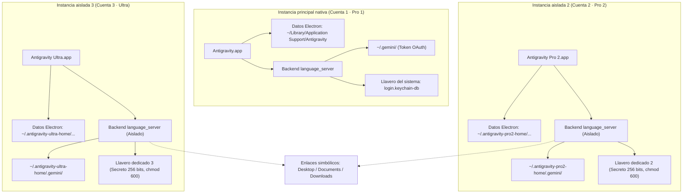

<p align="center">
  
</p>

<h1 align="center">Antigravity TwoUsers</h1>

<p align="center">
  <b>Gestor de Instancias Duales y Triples con Sandbox Físico para Google Antigravity en macOS (Pro 1 · Pro 2 · Ultra)</b><br>
  Supera los límites de 5 horas con cero colisión de cuentas, llavero dinámico de 256 bits y ejecución paralela real.
</p>

<p align="center">
  <a href="../README.md">简体中文</a> ·
  <a href="README.en.md">English</a> ·
  <a href="README.ja.md">日本語</a> ·
  <a href="README.ko.md">한국어</a> ·
  <b>Español</b> ·
  <a href="README.fr.md">Français</a> ·
  <a href="README.pt.md">Português</a>
</p>

<p align="center">
  <a href="https://apple.com"></a>
  
  
  
  <a href="../LICENSE"></a>
</p>

<p align="center">
  <a href="#-aspectos-destacados">✨ Destacados</a> •
  <a href="#-comparativa">⚖️ Comparativa</a> •
  <a href="#-arquitectura-de-sandbox-físico">🏗️ Arquitectura</a> •
  <a href="#-instalación-rápida">🚀 Instalación</a> •
  <a href="#-protocolo-de-relevo-multi-agente">🔄 Protocolo de Relevo</a> •
  <a href="#-seguridad-y-privacidad">🛡️ Seguridad</a> •
  <a href="#-preguntas-frecuentes-faq">❓ FAQ</a>
</p>

---

## ✨ Aspectos Destacados

<table>
  <tr>
    <td width="33%" valign="top">
      <h3>🧊 Sandbox Físico 100% Aislado</h3>
      Redirige tanto <code>$HOME</code> como <code>--user-data-dir</code> de Electron, separando por completo la caché de interfaz y el backend Go <code>language_server</code>.
    </td>
    <td width="33%" valign="top">
      <h3>🔐 Llavero Dinámico de 256 Bits</h3>
      Genera localmente una clave criptográfica única mediante <code>openssl rand -hex 32</code> con permisos <code>chmod 600</code>. Cero contraseñas fijas en el código.
    </td>
    <td width="33%" valign="top">
      <h3>♾️ Renovación Silenciosa 24/7</h3>
      Elimina el bloqueo por inactividad de 5 minutos del Llavero CLI de macOS para que las renovaciones OAuth cada hora nunca fallen.
    </td>
  </tr>
  <tr>
    <td width="33%" valign="top">
      <h3>🚀 Instancias Duales y Triples</h3>
      Instaladores en un clic para <b>Pro 2</b> y <b>Ultra (Instancia 3)</b>: ejecuta hasta 3 cuentas independientes en paralelo.
    </td>
    <td width="33%" valign="top">
      <h3>🖥️ Integración Nativa en el Dock</h3>
      Compila lanzadores nativos <code>.app</code> con iconos oficiales fijados en tu Dock y enlaza Escritorio, Documentos y Descargas automáticamente.
    </td>
    <td width="33%" valign="top">
      <h3>🧹 Cero Intrusión y Reversible</h3>
      Comparte el binario oficial sin duplicar gigabytes, nunca altera tu Llavero principal y deja la app original 100% intacta al desinstalar.
    </td>
  </tr>
</table>

---

## ⚖️ Comparativa

| Característica | App Nativa Única | Solo `--user-data-dir` | **Antigravity TwoUsers** |
| :--- | :---: | :---: | :---: |
| Ventanas paralelas multi-cuenta (2× / 3×) | ❌ | ❌ (Colisión en backend) | ✅ **Pro 1 + Pro 2 + Ultra** |
| Cambiar de cuenta sin cerrar sesión | ❌ | ❌ | ✅ **Sesiones aisladas permanentes** |
| Renovación automática de tokens OAuth | ✅ | ❌ (Llavero bloqueado) | ✅ **Sin tiempo límite, estable 24/7** |
| Sin contraseñas escritas en código | ✅ | — | ✅ **Secreto aleatorio 256 bits (`chmod 600`)** |
| Llavero principal del sistema intacto | ✅ | ⚠️ | ✅ **Aislamiento exclusivo por subproceso** |
| Acceso directo a repositorios locales | ✅ | ✅ | ✅ **Enlaces simbólicos automáticos** |

---

## 🏗️ Arquitectura de Sandbox Físico

<p align="center">
  
</p>

<details>
<summary><b>📐 Desplegar Diagrama Mermaid de Procesos y Flujo de Datos</b></summary>



</details>

### 🔬 3 Retos Técnicos Clave Resueltos

1. **Cero Colisión de Cuentas**: `--user-data-dir` solo cambia la caché de Electron mientras `language_server` sigue leyendo `$HOME/.gemini/`. Redirigir ambos elimina cualquier mezcla.
2. **Callbacks OAuth sin Conflictos**: Cada instancia enlaza su propio puerto efímero local Loopback HTTP en un contexto limpio, evitando el error *"Further action is required"*.
3. **Fin de Caídas de Modelos tras 1 Hora**: Desactivar el bloqueo por inactividad/suspensión con `security set-keychain-settings` junto con un secreto dinámico de 256 bits garantiza renovación continua.

---

## 🚀 Instalación Rápida

### Requisitos
* macOS 14+ (Apple Silicon M1–M4 o Intel)
* Google Antigravity oficial instalado en `/Applications/Antigravity.app`

### 1. Clonar el Repositorio
```bash
git clone https://github.com/Kongxijun88/antigravity-twousers.git
cd antigravity-twousers
```

### 2. Instalar Instancia 2 (`Antigravity Pro 2`)
```bash
chmod +x install.sh
./install.sh
```

### 3. Instalar Instancia 3 (`Antigravity Ultra`, Opcional)
```bash
chmod +x install-ultra.sh
./install-ultra.sh
```

### 📋 Resumen de Instancias

| Instancia | Aplicación (Dock / Aplicaciones) | Directorio Sandbox | Lanzador CLI |
| :--- | :--- | :--- | :--- |
| **Principal (Pro 1)** | `/Applications/Antigravity.app` | `~/.gemini/` (Por defecto) | — |
| **Instancia 2 (Pro 2)** | `/Applications/Antigravity Pro 2.app` | `~/.antigravity-pro2-home/` | `./scripts/launch.sh` |
| **Instancia 3 (Ultra)** | `/Applications/Antigravity Ultra.app` | `~/.antigravity-ultra-home/` | `./scripts/launch-ultra.sh` |

---

## 📂 Estructura del Proyecto

```text
antigravity-twousers/
├── install.sh                 # Instalador en un clic para Instancia 2 (Pro 2)
├── uninstall.sh               # Desinstalador limpio para Instancia 2
├── install-ultra.sh           # Instalador en un clic para Instancia 3 (Ultra)
├── uninstall-ultra.sh         # Desinstalador limpio para Instancia 3
├── scripts/
│   ├── launch.sh              # Ejecutor CLI independiente (Instancia 2)
│   └── launch-ultra.sh        # Ejecutor CLI independiente (Instancia 3)
├── assets/
│   ├── banner.png             # Portada principal del repositorio
│   └── architecture.png       # Infografía de arquitectura sandbox
├── docs/                      # Documentación multilingüe (EN / JA / KO / ES / FR / PT)
└── LICENSE                    # Licencia MIT
```

---

## 🔄 Protocolo de Relevo Multi-Agente

Saca el máximo partido a **2× Pro + 1× Ultra** combinando **asignación por complejidad + relevo con contexto**:

| Instancia | Rol Recomendado |
| :--- | :--- |
| **Antigravity (Pro 1)** | Desarrollo diario, ajustes UI, pruebas unitarias y correcciones rápidas |
| **Antigravity Pro 2** | Relevo inmediato cuando Pro 1 alcanza el límite de 5 horas |
| **Antigravity Ultra** | Refactorizaciones complejas, depuración profunda y arquitectura |

### Relevo en 2 Pasos

**Paso 1 — Guardar y entregar (Ventana activa):**
```text
Voy a cambiar en breve a otra cuenta para continuar este proyecto. Guarda todos los cambios, realiza un git commit limpio, genera un archivo HANDOVER.md con lo completado, decisiones clave y siguientes tareas, y escribe un mensaje breve que pueda pegar al siguiente agente.
```

**Paso 2 — Retomar al instante (Ventana Pro 2 / Ultra):**
Abre la misma carpeta del proyecto con `File -> Open Folder` y pega:
```text
Lee HANDOVER.md y el último git commit para entender el estado actual del proyecto, y continúa con la siguiente tarea pendiente.
```

---

## 🛡️ Seguridad y Privacidad

| Control | Implementación |
| :--- | :--- |
| **Cero Contraseñas Fijas** | Cada instalación genera su propia clave aleatoria de 256 bits vía `openssl rand -hex 32` |
| **Permisos Estrictos** | Tanto `.keychain_secret` como `login.keychain-db` se restringen a `chmod 600` (solo propietario) |
| **Sistema Anfitrión Intacto** | El aislamiento ocurre únicamente con `export HOME` en el subproceso sin alterar el llavero global |
| **100% Local y Auditable** | Scripts abiertos en Bash y Python sin telemetría ni conexiones externas |

---

## 🗑️ Desinstalación Limpia

```bash
# Desinstalar Instancia 2 (Antigravity Pro 2)
./uninstall.sh

# Desinstalar Instancia 3 (Antigravity Ultra)
./uninstall-ultra.sh
```

Detiene los procesos activos de esa instancia, elimina su `.app` y acceso del Dock, y te permite elegir entre borrar o conservar (bloqueado) su directorio sandbox. **Tu Antigravity original permanece intacto al 100%.**

---

## ❓ Preguntas Frecuentes (FAQ)

<details>
<summary><b>P1: ¿Puedo abrir proyectos de Escritorio o Descargas desde las instancias extra?</b></summary>
<br>
Sí. Cada sandbox crea enlaces simbólicos automáticos hacia <code>~/Desktop</code>, <code>~/Documents</code> y <code>~/Downloads</code>.
</details>

<details>
<summary><b>P2: ¿Se mezclarán las cuentas o se cerrará sesión al reiniciar el Mac?</b></summary>
<br>
<b>Nunca.</b> Cada instancia guarda sus credenciales de forma independiente en su propio sandbox y llavero dedicado.
</details>

<details>
<summary><b>P3: ¿Soporta mi Mac ejecutar las 3 instancias simultáneamente?</b></summary>
<br>
<b>Sin problema.</b> Comparten un solo binario en disco y cada instancia consume ~500MB–800MB de RAM (~2GB–2.5GB en total para las 3), funcionando con total fluidez en cualquier Mac Apple Silicon de 16GB+.
</details>

<details>
<summary><b>P4: ¿Pueden varias instancias abrir la misma carpeta Git a la vez?</b></summary>
<br>
<b>Sí.</b> Para evitar conflictos de edición simultánea, sigue el Protocolo de Relevo Multi-Agente descrito arriba.
</details>

<details>
<summary><b>P5: ¿Las extensiones y temas se comparten o son independientes?</b></summary>
<br>
<b>Totalmente independientes.</b> Consejo: asigna un tema de color distinto a cada instancia para distinguir Pro 1, Pro 2 y Ultra de un vistazo.
</details>

---

## 📄 Licencia

Publicado bajo la [Licencia MIT](../LICENSE). Si este proyecto te resultó útil, ¡regálale una **Star ⭐️**!
