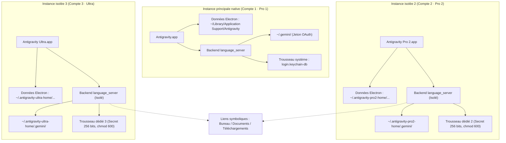

<p align="center">
  
</p>

<h1 align="center">Antigravity TwoUsers</h1>

<p align="center">
  <b>Gestionnaire Multi-Instances (Double &amp; Triple) avec Bac à Sable Physique pour Google Antigravity sur macOS (Pro 1 · Pro 2 · Ultra)</b><br>
  Dépassez les limites de 5h · Trousseau Dynamique 256 Bits · Routeur OAuth Intelligent · Travail Simultané Multi-Fenêtres
</p>

<p align="center">
  <a href="../README.md">简体中文</a> ·
  <a href="README.en.md">English</a> ·
  <a href="README.ja.md">日本語</a> ·
  <a href="README.ko.md">한국어</a> ·
  <a href="README.es.md">Español</a> ·
  <b>Français</b> ·
  <a href="README.pt.md">Português</a>
</p>

<p align="center">
  <a href="https://apple.com"></a>
  
  
  
  
  <a href="../LICENSE"></a>
</p>

<p align="center">
  <a href="#-points-forts">✨ Points forts</a> •
  <a href="#-comparatif">⚖️ Comparatif</a> •
  <a href="#-architecture-disolation-physique">🏗️ Architecture</a> •
  <a href="#-routeur-de-rappel-oauth-intelligent">🧭 Routeur OAuth</a> •
  <a href="#-installation-rapide">🚀 Installation</a> •
  <a href="#-protocole-de-relais-multi-agents">🔄 Relais</a> •
  <a href="#-sécurité-et-confidentialité">🛡️ Sécurité</a> •
  <a href="#-faq">❓ FAQ</a>
</p>

---

## ✨ Points Forts

<table>
  <tr>
    <td width="33%" valign="top">
      <h3>🧊 Bac à Sable Physique 100% Isolé</h3>
      Redirige simultanément <code>$HOME</code> et <code>--user-data-dir</code>, séparant totalement le cache Electron et le backend Go <code>language_server</code>.
    </td>
    <td width="33%" valign="top">
      <h3>🧭 Routeur OAuth Intelligent</h3>
      <b>Antigravity Router</b> en Swift natif intercepte <code>antigravity://</code> après l'authentification navigateur et ramène directement sur la fenêtre Pro 2 / Ultra d'origine.
    </td>
    <td width="33%" valign="top">
      <h3>🔐 Trousseau Dynamique 256 Bits</h3>
      Génère une clé cryptographique unique par installation via <code>openssl rand -hex 32</code> protégée en <code>chmod 600</code>. Zéro mot de passe en dur.
    </td>
  </tr>
  <tr>
    <td width="33%" valign="top">
      <h3>♾️ Renouvellement Silencieux 24/7</h3>
      Supprime le verrouillage d'inactivité de 5 minutes du Trousseau CLI macOS pour que le renouvellement OAuth horaire reste ininterrompu.
    </td>
    <td width="33%" valign="top">
      <h3>🚀 Double &amp; Triple Instances</h3>
      Scripts en un clic pour <b>Pro 2</b> et <b>Ultra (Instance 3)</b> avec icônes Dock natives et liens symboliques automatiques.
    </td>
    <td width="33%" valign="top">
      <h3>🧹 Non Intrusif &amp; Réversible</h3>
      Partage le binaire officiel sans doublon disque, ne touche jamais au Trousseau système et laisse l'app principale 100% intacte.
    </td>
  </tr>
</table>

---

## ⚖️ Comparatif

| Fonctionnalité | App Native Unique | `--user-data-dir` Seul | **Antigravity TwoUsers** |
| :--- | :---: | :---: | :---: |
| Fenêtres multi-comptes simultanées (2× / 3×) | ❌ | ❌ (Collision backend) | ✅ **Pro 1 + Pro 2 + Ultra** |
| « Ouvrir Antigravity » revient sur la bonne instance | — | ❌ (Ouvre toujours Principale) | ✅ **Routeur URL natif en Swift** |
| Changement de compte sans déconnexion | ❌ | ❌ | ✅ **Sessions isolées persistantes** |
| Renouvellement OAuth continu en arrière-plan | ✅ | ❌ (Trousseau verrouillé) | ✅ **Sans expiration, stable 24/7** |
| Aucun identifiant inscrit en dur | ✅ | — | ✅ **Secret 256 bits (`chmod 600`)** |
| Trousseau système hôte préservé | ✅ | ⚠️ | ✅ **Isolation par sous-processus** |

---

## 🏗️ Architecture d'Isolation Physique

<p align="center">
  
</p>

<details>
<summary><b>📐 Afficher le Diagramme Mermaid des Processus et Flux de Données</b></summary>



</details>

---

## 🧭 Routeur de Rappel OAuth Intelligent

<p align="center">
  
</p>

Sur macOS, `antigravity://` est lié globalement à l'application principale. Notre utilitaire natif Swift **`Antigravity Router.app`** (0 Mo au repos) résout cela grâce au **Routage Double Signal** :
1. **Signal 1 · Horodatage d'authentification** : Identifie le trousseau sandbox ayant reçu un jeton OAuth dans les 15 dernières secondes ;
2. **Signal 2 · Z-Order des fenêtres** : Utilise `CGWindowListCopyWindowInfo` (**zéro alerte de permission**) pour trouver le PID Antigravity juste derrière le navigateur ;
3. **Activation précise** : Ramène au premier plan la fenêtre **Primary / Pro 2 / Ultra** exacte et transmet tout paramètre deep-link à ce PID.

---

## 🚀 Installation Rapide

```bash
git clone https://github.com/Kongxijun88/antigravity-twousers.git
cd antigravity-twousers

# Installer l'Instance 2 (Antigravity Pro 2)
chmod +x install.sh && ./install.sh

# Installer l'Instance 3 (Antigravity Ultra, optionnel)
chmod +x install-ultra.sh && ./install-ultra.sh

# Installer le Routeur OAuth Intelligent (recommandé)
chmod +x install-router.sh && ./install-router.sh
```

> Diagnostic rapide : `"/Applications/Antigravity Router.app/Contents/MacOS/AntigravityRouter" --status`

---

## 📂 Structure du Projet

```text
antigravity-twousers/
├── install.sh                  # Installateur Instance 2 (Pro 2)
├── uninstall.sh                # Désinstallateur Instance 2
├── install-ultra.sh            # Installateur Instance 3 (Ultra)
├── uninstall-ultra.sh          # Désinstallateur Instance 3
├── install-router.sh           # Compile & enregistre le Routeur URL Swift
├── uninstall-router.sh         # Restaure le gestionnaire officiel antigravity://
├── router/
│   └── AntigravityRouter.swift # Source du routeur double signal
├── scripts/
│   ├── launch.sh               # Lanceur CLI Instance 2
│   └── launch-ultra.sh         # Lanceur CLI Instance 3
├── assets/                     # Bannière, architecture, routeur et relais
├── docs/                       # Documentation multilingue (EN / JA / KO / ES / FR / PT)
└── LICENSE                     # Licence MIT
```

---

## 🔄 Protocole de Relais Multi-Agents

<p align="center">
  
</p>

| Instance | Rôle Recommandé |
| :--- | :--- |
| **Antigravity (Pro 1)** | Développement quotidien, ajustements UI, tests unitaires et correctifs |
| **Antigravity Pro 2** | Relais instantané lorsque Pro 1 atteint la limite des 5 heures |
| **Antigravity Ultra** | Refactorisations complexes, débogage avancé et architecture système |

---

## 🛡️ Sécurité et Confidentialité

| Mesure | Implémentation |
| :--- | :--- |
| **Zéro Mot de Passe en Dur** | Clé aléatoire 256 bits générée localement via `openssl rand -hex 32` |
| **Permissions Strictes** | `.keychain_secret` et `login.keychain-db` verrouillés en `chmod 600` |
| **Trousseau Hôte Intact** | Isolation exclusive via `export HOME` dans le sous-processus |
| **100% Local & Auditable** | Code open-source Swift, Bash et Python sans télémétrie |

---

## 🗑️ Désinstallation Propre

```bash
./uninstall.sh          # Désinstaller l'Instance 2
./uninstall-ultra.sh    # Désinstaller l'Instance 3
./uninstall-router.sh   # Désinstaller le Routeur et restaurer antigravity://
```

---

## ❓ FAQ

<details>
<summary><b>Q1 : Puis-je accéder à mes projets du Bureau ou Téléchargements depuis les instances supplémentaires ?</b></summary>
<br>
Oui. Chaque sandbox crée automatiquement des liens symboliques vers <code>~/Desktop</code>, <code>~/Documents</code> et <code>~/Downloads</code>.
</details>

<details>
<summary><b>Q2 : Un redémarrage du Mac risque-t-il de mélanger les comptes ou de me déconnecter ?</b></summary>
<br>
<b>Jamais.</b> Chaque instance conserve ses identifiants dans son propre dossier isolé et son trousseau dédié.
</details>

<details>
<summary><b>Q3 : Est-il normal que le navigateur demande « Ouvrir Antigravity Router ? » après connexion ?</b></summary>
<br>
<b>Oui !</b> Cochez « Toujours autoriser » afin que les prochaines connexions reviennent automatiquement sur la bonne fenêtre.
</details>

<details>
<summary><b>Q4 : Mon Mac peut-il faire tourner les 3 instances en même temps ?</b></summary>
<br>
<b>Sans difficulté.</b> Elles partagent un seul binaire et consomment ~2 à 2,5 Go de RAM au total pour les 3, très fluide sur tout Mac Apple Silicon 16 Go+.
</details>

---

## 📄 Licence

Distribué sous [Licence MIT](../LICENSE). Si ce projet vous est utile, offrez-lui une **Star ⭐️** !
