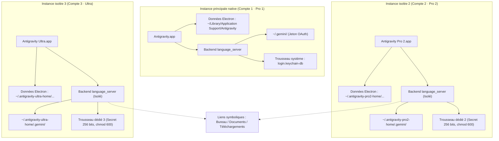

<p align="center">
  
</p>

<h1 align="center">Antigravity TwoUsers</h1>

<p align="center">
  <b>Gestionnaire Multi-Instances (Double &amp; Triple) avec Bac à Sable Physique pour Google Antigravity sur macOS (Pro 1 · Pro 2 · Ultra)</b><br>
  Dépassez les limites de 5 heures sans collision de comptes, avec trousseau dynamique 256 bits et travail simultané multi-fenêtres.
</p>

<p align="center">
  <a href="../README.md">简体中文</a> ·
  <a href="README.en.md">English</a> ·
  <a href="README.ja.md">日本語</a> ·
  <a href="README.ko.md">한국어</a> ·
  <a href="README.es.md">Español</a> ·
  <b>Français</b> ·
  <a href="README.pt.md">Português</a>
</p>

<p align="center">
  <a href="https://apple.com"></a>
  
  
  
  <a href="../LICENSE"></a>
</p>

<p align="center">
  <a href="#-points-forts">✨ Points forts</a> •
  <a href="#-comparatif">⚖️ Comparatif</a> •
  <a href="#-architecture-disolation-physique">🏗️ Architecture</a> •
  <a href="#-installation-rapide">🚀 Installation</a> •
  <a href="#-protocole-de-relais-multi-agents">🔄 Relais</a> •
  <a href="#-sécurité-et-confidentialité">🛡️ Sécurité</a> •
  <a href="#-faq">❓ FAQ</a>
</p>

---

## ✨ Points Forts

<table>
  <tr>
    <td width="33%" valign="top">
      <h3>🧊 Bac à Sable Physique 100% Isolé</h3>
      Redirige simultanément <code>$HOME</code> et <code>--user-data-dir</code>, séparant totalement le cache Electron et le backend Go <code>language_server</code>.
    </td>
    <td width="33%" valign="top">
      <h3>🔐 Trousseau Dynamique 256 Bits</h3>
      Génère une clé cryptographique unique par installation via <code>openssl rand -hex 32</code> protégée en <code>chmod 600</code>. Zéro mot de passe en dur.
    </td>
    <td width="33%" valign="top">
      <h3>♾️ Renouvellement Silencieux 24/7</h3>
      Supprime le verrouillage d'inactivité de 5 minutes du Trousseau CLI macOS afin que le renouvellement OAuth horaire reste ininterrompu.
    </td>
  </tr>
  <tr>
    <td width="33%" valign="top">
      <h3>🚀 Double &amp; Triple Instances</h3>
      Scripts en un clic pour <b>Pro 2</b> et <b>Ultra (Instance 3)</b> : exécutez jusqu'à 3 comptes indépendants côte à côte.
    </td>
    <td width="33%" valign="top">
      <h3>🖥️ Intégration Native au Dock</h3>
      Compile des lanceurs macOS <code>.app</code> avec icônes officielles épinglés au Dock, avec liens symboliques vers Bureau, Documents et Téléchargements.
    </td>
    <td width="33%" valign="top">
      <h3>🧹 Non Intrusif &amp; Réversible</h3>
      Partage le binaire officiel sans doublon disque, ne touche jamais au Trousseau système et laisse l'app principale 100% intacte à la désinstallation.
    </td>
  </tr>
</table>

---

## ⚖️ Comparatif

| Fonctionnalité | App Native Unique | `--user-data-dir` Seul | **Antigravity TwoUsers** |
| :--- | :---: | :---: | :---: |
| Fenêtres multi-comptes simultanées (2× / 3×) | ❌ | ❌ (Collision backend) | ✅ **Pro 1 + Pro 2 + Ultra** |
| Changement de compte sans déconnexion | ❌ | ❌ | ✅ **Sessions isolées persistantes** |
| Renouvellement OAuth continu en arrière-plan | ✅ | ❌ (Trousseau verrouillé) | ✅ **Sans expiration, stable 24/7** |
| Aucun identifiant inscrit en dur | ✅ | — | ✅ **Secret aléatoire 256 bits (`chmod 600`)** |
| Trousseau système hôte préservé | ✅ | ⚠️ | ✅ **Isolation limitée au sous-processus** |
| Accès direct aux dépôts Git locaux | ✅ | ✅ | ✅ **Liens symboliques automatiques** |

---

## 🏗️ Architecture d'Isolation Physique

<p align="center">
  
</p>

<details>
<summary><b>📐 Afficher le Diagramme Mermaid des Processus et Flux de Données</b></summary>



</details>

### 🔬 3 Défis Techniques Majeurs Résolus

1. **Suppression des Collisions de Sessions** : `--user-data-dir` ne déplace que le cache Electron alors que `language_server` lit toujours `$HOME/.gemini/`. La double redirection garantit une séparation hermétique.
2. **Callbacks OAuth Sans Conflit** : Chaque instance écoute sur son propre port local Loopback HTTP dans un contexte propre, évitant l'erreur *"Further action is required"*.
3. **Fin des Coupures Après 1 Heure** : La désactivation du verrouillage d'inactivité/veille via `security set-keychain-settings` alliée à un secret dynamique 256 bits assure un rafraîchissement continu.

---

## 🚀 Installation Rapide

### Prérequis
* macOS 14+ (Apple Silicon M1–M4 ou Intel)
* Application officielle installée dans `/Applications/Antigravity.app`

### 1. Cloner le Dépôt
```bash
git clone https://github.com/Kongxijun88/antigravity-twousers.git
cd antigravity-twousers
```

### 2. Installer l'Instance 2 (`Antigravity Pro 2`)
```bash
chmod +x install.sh
./install.sh
```

### 3. Installer l'Instance 3 (`Antigravity Ultra`, Optionnel)
```bash
chmod +x install-ultra.sh
./install-ultra.sh
```

### 📋 Vue d'Ensemble des Instances

| Instance | Lanceur (Dock / Applications) | Répertoire Sandbox | Lanceur CLI |
| :--- | :--- | :--- | :--- |
| **Principale (Pro 1)** | `/Applications/Antigravity.app` | `~/.gemini/` (Par défaut) | — |
| **Instance 2 (Pro 2)** | `/Applications/Antigravity Pro 2.app` | `~/.antigravity-pro2-home/` | `./scripts/launch.sh` |
| **Instance 3 (Ultra)** | `/Applications/Antigravity Ultra.app` | `~/.antigravity-ultra-home/` | `./scripts/launch-ultra.sh` |

---

## 📂 Structure du Projet

```text
antigravity-twousers/
├── install.sh                 # Installateur en un clic pour l'Instance 2 (Pro 2)
├── uninstall.sh               # Désinstallateur propre pour l'Instance 2
├── install-ultra.sh           # Installateur en un clic pour l'Instance 3 (Ultra)
├── uninstall-ultra.sh         # Désinstallateur propre pour l'Instance 3
├── scripts/
│   ├── launch.sh              # Lanceur CLI autonome (Instance 2)
│   └── launch-ultra.sh        # Lanceur CLI autonome (Instance 3)
├── assets/
│   ├── banner.png             # Bannière principale du dépôt
│   └── architecture.png       # Infographie d'architecture sandbox
├── docs/                      # Documentation multilingue (EN / JA / KO / ES / FR / PT)
└── LICENSE                    # Licence MIT
```

---

## 🔄 Protocole de Relais Multi-Agents

Tirez le meilleur parti de **2× Pro + 1× Ultra** via la **répartition par complexité + relais sans perte de contexte** :

| Instance | Rôle Recommandé |
| :--- | :--- |
| **Antigravity (Pro 1)** | Développement quotidien, ajustements UI, tests unitaires et correctifs |
| **Antigravity Pro 2** | Relais instantané lorsque Pro 1 atteint la limite des 5 heures |
| **Antigravity Ultra** | Refactorisations complexes, débogage avancé et architecture système |

### Passage de Relais en 2 Étapes

**Étape 1 — Sauvegarder & Transmettre (Fenêtre active) :**
```text
Je vais bientôt basculer sur un autre compte pour poursuivre ce projet. Enregistre toutes les modifications, effectue un git commit propre, génère un fichier HANDOVER.md résumant le travail accompli, les choix clés et les prochaines étapes, et rédige un court prompt de reprise pour l'agent suivant.
```

**Étape 2 — Reprendre Instantanément (Fenêtre Pro 2 / Ultra) :**
Ouvrez le même dossier via `File -> Open Folder` et collez :
```text
Lis HANDOVER.md ainsi que le dernier git commit pour comprendre l'état actuel du projet, puis poursuis avec la prochaine tâche prévue.
```

---

## 🛡️ Sécurité et Confidentialité

| Mesure | Implémentation |
| :--- | :--- |
| **Zéro Mot de Passe en Dur** | Chaque installation génère localement une clé aléatoire de 256 bits via `openssl rand -hex 32` |
| **Permissions Strictes** | `.keychain_secret` et `login.keychain-db` sont verrouillés en `chmod 600` (propriétaire uniquement) |
| **Trousseau Hôte Intact** | Le routage s'effectue uniquement par `export HOME` dans le sous-processus sans modifier le trousseau global |
| **100% Local & Auditable** | Scripts Bash et Python transparents, sans télémétrie ni appel réseau externe |

---

## 🗑️ Désinstallation Propre

```bash
# Désinstaller l'Instance 2 (Antigravity Pro 2)
./uninstall.sh

# Désinstaller l'Instance 3 (Antigravity Ultra)
./uninstall-ultra.sh
```

Ferme l'instance concernée, supprime le `.app` et l'icône du Dock, puis propose de supprimer ou de conserver (verrouillées) les données sandbox. **Votre Antigravity d'origine reste 100% intact.**

---

## ❓ FAQ

<details>
<summary><b>Q1 : Puis-je accéder à mes projets du Bureau ou Téléchargements depuis les instances supplémentaires ?</b></summary>
<br>
Oui. Chaque sandbox crée automatiquement des liens symboliques vers <code>~/Desktop</code>, <code>~/Documents</code> et <code>~/Downloads</code>.
</details>

<details>
<summary><b>Q2 : Un redémarrage du Mac risque-t-il de mélanger les comptes ou de me déconnecter ?</b></summary>
<br>
<b>Jamais.</b> Chaque instance conserve ses identifiants dans son propre dossier isolé et son trousseau dédié.
</details>

<details>
<summary><b>Q3 : Mon Mac peut-il faire tourner les 3 instances en même temps ?</b></summary>
<br>
<b>Sans difficulté.</b> Elles partagent un seul binaire disque et chaque instance utilise ~500 à 800 Mo de RAM (~2 à 2,5 Go au total), ce qui reste fluide sur tout Mac Apple Silicon 16 Go+.
</details>

<details>
<summary><b>Q4 : Plusieurs instances peuvent-elles ouvrir le même dépôt Git simultanément ?</b></summary>
<br>
<b>Oui.</b> Suivez le Protocole de Relais Multi-Agents ci-dessus pour éviter que deux agents n'éditent le même fichier simultanément.
</details>

<details>
<summary><b>Q5 : Les extensions et thèmes sont-ils partagés ou indépendants ?</b></summary>
<br>
<b>Entièrement indépendants.</b> Astuce : appliquez un thème de couleur différent à chaque instance pour reconnaître Pro 1, Pro 2 et Ultra au premier coup d'œil !
</details>

---

## 📄 Licence

Distribué sous [Licence MIT](../LICENSE). Si ce projet vous est utile, n'hésitez pas à lui offrir une **Star ⭐️** !
