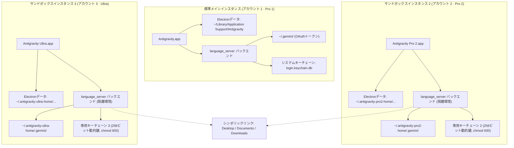

<p align="center">
  
</p>

<h1 align="center">Antigravity TwoUsers</h1>

<p align="center">
  <b>macOS向け Google Antigravity デュアル／トリプル完全物理サンドボックス管理ツール（Pro 1 · Pro 2 · Ultra）</b><br>
  5時間レート制限を回避し、256ビット動的キーチェーン保護のもと複数アカウントを完全隔離で同時稼働。
</p>

<p align="center">
  <a href="../README.md">简体中文</a> ·
  <a href="README.en.md">English</a> ·
  <b>日本語</b> ·
  <a href="README.ko.md">한국어</a> ·
  <a href="README.es.md">Español</a> ·
  <a href="README.fr.md">Français</a> ·
  <a href="README.pt.md">Português</a>
</p>

<p align="center">
  <a href="https://apple.com"></a>
  
  
  
  <a href="../LICENSE"></a>
</p>

<p align="center">
  <a href="#-主な特長">✨ 主な特長</a> •
  <a href="#-方式比較">⚖️ 方式比較</a> •
  <a href="#-物理サンドボックス隔離アーキテクチャ">🏗️ アーキテクチャ</a> •
  <a href="#-クイックスタート">🚀 クイックスタート</a> •
  <a href="#-マルチagentリレーワークフロー">🔄 リレー運用</a> •
  <a href="#-セキュリティとプライバシー">🛡️ セキュリティ</a> •
  <a href="#-よくある質問-faq">❓ FAQ</a>
</p>

---

## ✨ 主な特長

<table>
  <tr>
    <td width="33%" valign="top">
      <h3>🧊 100% 物理サンドボックス隔離</h3>
      <code>$HOME</code> と Electron <code>--user-data-dir</code> の双方をリダイレクトし、UIキャッシュとGo製 <code>language_server</code> のアカウント混線を完全に防止。
    </td>
    <td width="33%" valign="top">
      <h3>🔐 256ビット動的秘密鍵保護</h3>
      インストール時に <code>openssl rand -hex 32</code> で固有の256ビット乱数パスワードを生成し <code>chmod 600</code> で保管。ハードコード一切なし。
    </td>
    <td width="33%" valign="top">
      <h3>♾️ トークン自動更新を常時維持</h3>
      macOS CLIキーチェーン特有の5分自動ロックを解除し、1時間ごとのGoogle OAuth更新が24時間安定稼働。
    </td>
  </tr>
  <tr>
    <td width="33%" valign="top">
      <h3>🚀 2重・3重同時起動に対応</h3>
      <b>Pro 2</b> と <b>Ultra（第3インスタンス）</b>のワンクリック導入スクリプトを同梱。最大3アカウントを並べて同時稼働可能。
    </td>
    <td width="33%" valign="top">
      <h3>🖥️ macOS Dock ネイティブ統合</h3>
      公式アイコン付きの <code>.app</code> ランチャーを自動生成してDockに追加。Desktop・Documents・Downloadsも自動リンク。
    </td>
    <td width="33%" valign="top">
      <h3>🧹 非侵襲・クリーンな復元</h3>
      本体バイナリを共有して容量節約。ホスト標準キーチェーンを一切変更せず、アンインストール時もメイン環境に無影響。
    </td>
  </tr>
</table>

---

## ⚖️ 方式比較

| 比較項目 | 標準（単一起動） | `--user-data-dir` のみ | **Antigravity TwoUsers** |
| :--- | :---: | :---: | :---: |
| 複数アカウント同時稼働（2重／3重） | ❌ | ❌（バックエンド混線） | ✅ **Pro 1 + Pro 2 + Ultra 対応** |
| ログアウト不要でのアカウント切替 | ❌ | ❌ | ✅ **ログイン状態を個別に永続保持** |
| OAuth トークン自動更新の安定性 | ✅ | ❌（キーチェーンロック） | ✅ **タイムアウト無効で24時間稼働** |
| パスワードの安全性（ハードコードなし） | ✅ | — | ✅ **256ビット乱数鍵 + `chmod 600`** |
| ホスト標準キーチェーンへの非干渉 | ✅ | ⚠️ | ✅ **サブプロセス隔離のみ** |
| デスクトップ／Gitリポジトリへの直接アクセス | ✅ | ✅ | ✅ **シンボリックリンク自動構成** |

---

## 🏗️ 物理サンドボックス隔離アーキテクチャ

<p align="center">
  
</p>

<details>
<summary><b>📐 Mermaid プロセス・データフロー図を展開</b></summary>



</details>

### 🔬 解決した3大技術課題

1. **セッション混線の解消**：`--user-data-dir` だけではGo製バックエンドが `$HOME/.gemini/` を参照し続けます。`$HOME` と `--user-data-dir` を同時に切り替えることで完全分離を実現しました。
2. **OAuth コールバックのクリーンな結合**：一時的なローカルLoopback HTTPポートを各独立コンテキストで確保し、*"Further action is required"* エラーを回避します。
3. **数時間後のモデル無効化を根治**：CLI作成キーチェーンの300秒自動ロックおよびスリープ時ロックを `security set-keychain-settings` で解除し、256ビット動的鍵と組み合わせて無停止のトークン更新を保証します。

---

## 🚀 クイックスタート

### 動作要件
* macOS 14+（Apple Silicon M1–M4 / Intel 対応）
* `/Applications/Antigravity.app` がインストール済みであること

### 1. リポジトリのクローン
```bash
git clone https://github.com/Kongxijun88/antigravity-twousers.git
cd antigravity-twousers
```

### 2. 第2インスタンス（`Antigravity Pro 2`）の導入
```bash
chmod +x install.sh
./install.sh
```

### 3. 第3インスタンス（`Antigravity Ultra`）の導入（任意）
```bash
chmod +x install-ultra.sh
./install-ultra.sh
```

### 📋 インスタンス構成一覧

| インスタンス | アプリランチャー（Dock / Applications） | 隔離サンドボックス | CLIデバッグ起動 |
| :--- | :--- | :--- | :--- |
| **メイン (Pro 1)** | `/Applications/Antigravity.app` | `~/.gemini/`（システム標準） | — |
| **第2 (Pro 2)** | `/Applications/Antigravity Pro 2.app` | `~/.antigravity-pro2-home/` | `./scripts/launch.sh` |
| **第3 (Ultra)** | `/Applications/Antigravity Ultra.app` | `~/.antigravity-ultra-home/` | `./scripts/launch-ultra.sh` |

---

## 📂 プロジェクト構成

```text
antigravity-twousers/
├── install.sh                 # 第2インスタンス (Pro 2) インストーラー
├── uninstall.sh               # 第2インスタンス アンインストーラー
├── install-ultra.sh           # 第3インスタンス (Ultra) インストーラー
├── uninstall-ultra.sh         # 第3インスタンス アンインストーラー
├── scripts/
│   ├── launch.sh              # 第2インスタンス CLI起動スクリプト
│   └── launch-ultra.sh        # 第3インスタンス CLI起動スクリプト
├── assets/
│   ├── banner.png             # ヒーローバナー画像
│   └── architecture.png       # 隔離アーキテクチャ図
├── docs/                      # 多言語ドキュメント (EN / JA / KO / ES / FR / PT)
└── LICENSE                    # MIT License
```

---

## 🔄 マルチAgentリレーワークフロー

複数アカウント（**Pro×2 + Ultra×1**）を最大限に活かす**役割分担＋文脈引き継ぎプロトコル**：

| インスタンス | おすすめの役割 |
| :--- | :--- |
| **Antigravity (Pro 1)** | 日常の機能開発・UI調整・テスト作成・軽微なバグ修正 |
| **Antigravity Pro 2** | Pro 1 の5時間制限到達時のシームレスなリレー交代枠 |
| **Antigravity Ultra** | 大規模リファクタリング・難解な障害調査・高度な設計推論 |

### 2ステップ引き継ぎプロンプト

**ステップ1（作業中のウィンドウ）：**
```text
まもなく別のアカウントに切り替えてこのプロジェクトを続行します。現在の変更をすべて保存してgit commitを作成し、完了内容・設計方針・次のタスクをまとめた HANDOVER.md をルートに生成したうえで、次のAgentへ貼り付ける短い引き継ぎ文を出力してください。
```

**ステップ2（次のPro 2／Ultraウィンドウ）：**
同じフォルダを開いて貼り付け：
```text
プロジェクトの HANDOVER.md と最新の git commit を確認して現状を把握し、次の未完了タスクを進めてください。
```

---

## 🛡️ セキュリティとプライバシー

| セキュリティ項目 | 実装内容 |
| :--- | :--- |
| **パスワードのハードコード排除** | インストール時に `openssl rand -hex 32` で端末固有の256ビット乱数鍵を動的生成 |
| **厳格なパーミッション制御** | `.keychain_secret` と `login.keychain-db` は双方 `chmod 600`（所有者のみアクセス可） |
| **ホスト標準キーチェーン非改変** | サブプロセス内の `export HOME` でルーティングし、システム標準キーチェーン設定を一切変更しない |
| **完全ローカル・透明なコード** | 外部送信ゼロのオープンソース Bash / Python スクリプトのみで構成 |

---

## 🗑️ アンインストール

```bash
# 第2インスタンス (Antigravity Pro 2) の削除
./uninstall.sh

# 第3インスタンス (Antigravity Ultra) の削除
./uninstall-ultra.sh
```

稼働中プロセスの停止、`.app` およびDockアイコンの削除を行い、サンドボックスデータの削除またはロック保持を選択できます。**メインのAntigravityとアカウント1には一切影響しません。**

---

## ❓ よくある質問 (FAQ)

<details>
<summary><b>Q1: 追加インスタンスからデスクトップやダウンロードのプロジェクトを開けますか？</b></summary>
<br>
はい。各サンドボックス内に <code>~/Desktop</code>・<code>~/Documents</code>・<code>~/Downloads</code> のシンボリックリンクが自動生成されます。
</details>

<details>
<summary><b>Q2: Macを再起動するとログインが切れたりアカウントが混ざったりしますか？</b></summary>
<br>
<b>一切ありません。</b> 各アカウントの認証情報は完全に分離されたキーチェーンとディレクトリに永続保存されます。
</details>

<details>
<summary><b>Q3: 3インスタンス同時起動でMacのメモリは足りますか？</b></summary>
<br>
<b>余裕で動作します。</b> バイナリ本体は共通利用され、1インスタンスあたりの稼働メモリは約500MB〜800MB（3つ同時で合計2GB〜2.5GB程度）のため、16GB以上のApple Silicon Macで快適に動作します。
</details>

<details>
<summary><b>Q4: 複数インスタンスで同じGitリポジトリを同時に開けますか？</b></summary>
<br>
<b>可能です。</b> 未保存の書き込み競合を防ぐため、上記リレーワークフローに沿って交互に操作することを推奨します。
</details>

<details>
<summary><b>Q5: 拡張機能やテーマは共有されますか、独立していますか？</b></summary>
<br>
<b>完全に独立しています。</b> ウィンドウごとに異なるカラーテーマを設定しておくと、Pro 1 / Pro 2 / Ultra を一目で区別できて便利です。
</details>

---

## 📄 ライセンス

本プロジェクトは [MIT License](../LICENSE) で公開されています。役に立ったらぜひ **Star ⭐️** をお願いします！
