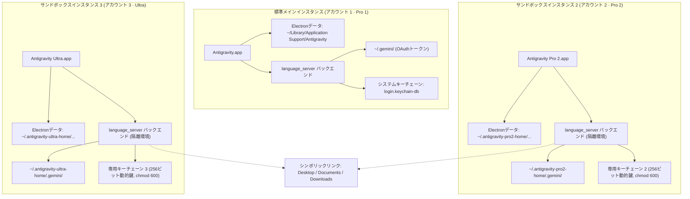
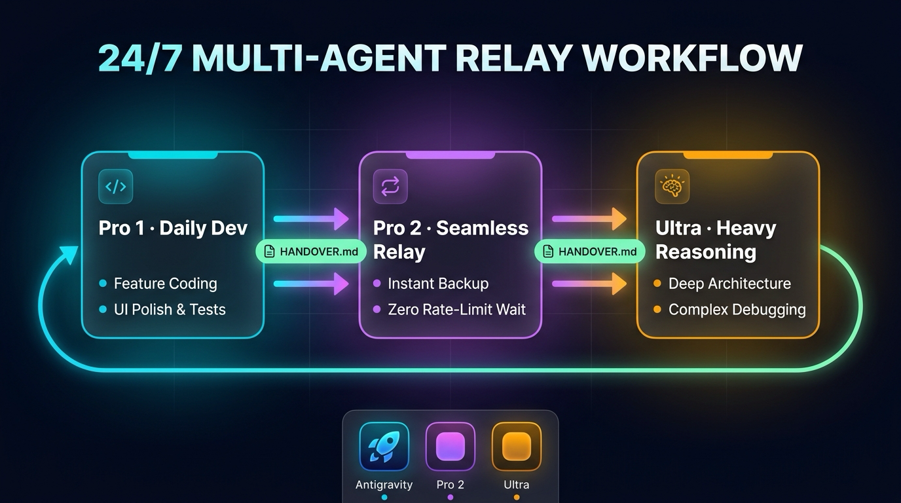

<p align="center">
  
</p>

<h1 align="center">Antigravity TwoUsers</h1>

<p align="center">
  <b>macOS向け Google Antigravity デュアル／トリプル完全物理サンドボックス管理ツール（Pro 1 · Pro 2 · Ultra）</b><br>
  5時間レート制限を回避 · 256ビット動的キーチェーン · スマートOAuthコールバックルーター · 複数ウィンドウ同時稼働
</p>

<p align="center">
  <a href="../README.md">简体中文</a> ·
  <a href="README.en.md">English</a> ·
  <b>日本語</b> ·
  <a href="README.ko.md">한국어</a> ·
  <a href="README.es.md">Español</a> ·
  <a href="README.fr.md">Français</a> ·
  <a href="README.pt.md">Português</a>
</p>

<p align="center">
  <a href="https://apple.com"></a>
  
  
  
  
  <a href="../LICENSE"></a>
</p>

<p align="center">
  <a href="#-主な特長">✨ 主な特長</a> •
  <a href="#-方式比較">⚖️ 方式比較</a> •
  <a href="#-物理サンドボックス隔離アーキテクチャ">🏗️ アーキテクチャ</a> •
  <a href="#-スマート-oauth-コールバックルーター">🧭 スマート自動切替</a> •
  <a href="#-クイックスタート">🚀 クイックスタート</a> •
  <a href="#-マルチagentリレーワークフロー">🔄 リレー運用</a> •
  <a href="#-セキュリティとプライバシー">🛡️ セキュリティ</a> •
  <a href="#-よくある質問-faq">❓ FAQ</a>
</p>

---

## ✨ 主な特長

<table>
  <tr>
    <td width="33%" valign="top">
      <h3>🧊 100% 物理サンドボックス隔離</h3>
      <code>$HOME</code> と Electron <code>--user-data-dir</code> の双方をリダイレクトし、UIキャッシュとGo製 <code>language_server</code> の混線を完全防止。
    </td>
    <td width="33%" valign="top">
      <h3>🧭 スマート OAuth コールバックルーター</h3>
      ネイティブSwift製 <b>Antigravity Router</b> が <code>antigravity://</code> を自動判定し、認証元の Pro 2 / Ultra ウィンドウへ直接復帰。
    </td>
    <td width="33%" valign="top">
      <h3>🔐 256ビット動的秘密鍵保護</h3>
      インストール時に <code>openssl rand -hex 32</code> で固有の256ビット乱数鍵を生成し <code>chmod 600</code> で保管。ハードコード一切なし。
    </td>
  </tr>
  <tr>
    <td width="33%" valign="top">
      <h3>♾️ トークン自動更新を常時維持</h3>
      macOS CLIキーチェーンの5分自動ロックを解除し、1時間ごとのGoogle OAuth更新が24時間安定稼働。
    </td>
    <td width="33%" valign="top">
      <h3>🚀 2重・3重同時起動に対応</h3>
      <b>Pro 2</b> と <b>Ultra（第3インスタンス）</b>をワンクリック導入。Dockネイティブ統合＋デスクトップ自動リンク。
    </td>
    <td width="33%" valign="top">
      <h3>🧹 非侵襲・クリーンな復元</h3>
      本体バイナリを共有して容量節約。ホスト標準キーチェーンを一切改変せず、アンインストール時もメイン環境に無影響。
    </td>
  </tr>
</table>

---

## ⚖️ 方式比較

| 比較項目 | 標準（単一起動） | `--user-data-dir` のみ | **Antigravity TwoUsers** |
| :--- | :---: | :---: | :---: |
| 複数アカウント同時稼働（2重／3重） | ❌ | ❌（バックエンド混線） | ✅ **Pro 1 + Pro 2 + Ultra 対応** |
| ブラウザ認証後の正確なウィンドウ復帰 | — | ❌（常にメインへ復帰） | ✅ **Swift製スマートURLルーター** |
| ログアウト不要でのアカウント切替 | ❌ | ❌ | ✅ **ログイン状態を個別に永続保持** |
| OAuth トークン自動更新の安定性 | ✅ | ❌（キーチェーンロック） | ✅ **タイムアウト無効で24時間稼働** |
| パスワードの安全性（ハードコードなし） | ✅ | — | ✅ **256ビット乱数鍵 + `chmod 600`** |
| ホスト標準キーチェーンへの非干渉 | ✅ | ⚠️ | ✅ **サブプロセス隔離のみ** |

---

## 🏗️ 物理サンドボックス隔離アーキテクチャ

<p align="center">
  
</p>

<details>
<summary><b>📐 Mermaid プロセス・データフロー図を展開</b></summary>



</details>

---

## 🧭 スマート OAuth コールバックルーター

<p align="center">
  
</p>

macOSでは `antigravity://` がメインアプリに固定登録されるため、Pro 2 や Ultra で認証完了後にブラウザの「Antigravity を開く」を押すとメインウィンドウへ戻ってしまいます。

同梱のネイティブSwift製 **`Antigravity Router.app`**（常駐負荷ゼロ）が**デュアルシグナル判定**でこれを解決します：
1. **シグナル 1 · 認証書き込みタイムスタンプ**：直近15秒以内に専用キーチェーンへトークンが書き込まれたインスタンスを最優先で特定；
2. **シグナル 2 · ウィンドウZオーダー**：権限ダイアログ不要の `CGWindowListCopyWindowInfo` でブラウザ直下にいたインスタンスPIDを特定；
3. **ピンポイント復帰＆転送**：該当する **Primary / Pro 2 / Ultra** ウィンドウを即座に最前面化し、ディープリンク引数も対象PIDへ直接転送します。

---

## 🚀 クイックスタート

### 動作要件
* macOS 14+（Apple Silicon M1–M4 / Intel 対応）
* `/Applications/Antigravity.app` がインストール済みであること
* スマートURLルーター利用時は `swiftc`（Xcode Command Line Tools）

```bash
git clone https://github.com/Kongxijun88/antigravity-twousers.git
cd antigravity-twousers

# 第2インスタンス (Antigravity Pro 2)
chmod +x install.sh && ./install.sh

# 第3インスタンス (Antigravity Ultra・任意)
chmod +x install-ultra.sh && ./install-ultra.sh

# スマートOAuthコールバックルーター (推奨)
chmod +x install-router.sh && ./install-router.sh
```

> 診断コマンド：`"/Applications/Antigravity Router.app/Contents/MacOS/AntigravityRouter" --status`

---

## 📂 プロジェクト構成

```text
antigravity-twousers/
├── install.sh                  # 第2インスタンス (Pro 2) インストーラー
├── uninstall.sh                # 第2インスタンス アンインストーラー
├── install-ultra.sh            # 第3インスタンス (Ultra) インストーラー
├── uninstall-ultra.sh          # 第3インスタンス アンインストーラー
├── install-router.sh           # ネイティブSwift製スマートURLルーター導入
├── uninstall-router.sh         # 標準 antigravity:// ハンドラへ復元
├── router/
│   └── AntigravityRouter.swift # デュアルシグナルURLルーター実装
├── scripts/
│   ├── launch.sh               # 第2インスタンス CLI起動
│   └── launch-ultra.sh         # 第3インスタンス CLI起動
├── assets/                     # バナー・アーキテクチャ・ルーター・リレー図版
├── docs/                       # 多言語ドキュメント (EN / JA / KO / ES / FR / PT)
└── LICENSE                     # MIT License
```

---

## 🔄 マルチAgentリレーワークフロー

<p align="center">
  
</p>

| インスタンス | おすすめの役割 |
| :--- | :--- |
| **Antigravity (Pro 1)** | 日常の機能開発・UI調整・テスト作成・軽微なバグ修正 |
| **Antigravity Pro 2** | Pro 1 の5時間制限到達時のシームレスなリレー交代枠 |
| **Antigravity Ultra** | 大規模リファクタリング・難解な障害調査・高度な設計推論 |

---

## 🛡️ セキュリティとプライバシー

| セキュリティ項目 | 実装内容 |
| :--- | :--- |
| **パスワードのハードコード排除** | `openssl rand -hex 32` で端末固有の256ビット乱数鍵を動的生成 |
| **厳格なパーミッション制御** | `.keychain_secret` と `login.keychain-db` は双方 `chmod 600` |
| **ホスト標準キーチェーン非改変** | サブプロセス内の `export HOME` のみで隔離し、システム標準設定を改変しない |
| **完全ローカル・透明なコード** | 外部送信ゼロのオープンソース Swift / Bash / Python で構成 |

---

## 🗑️ アンインストール

```bash
./uninstall.sh          # 第2インスタンス削除
./uninstall-ultra.sh    # 第3インスタンス削除
./uninstall-router.sh   # ルーター削除・標準ハンドラ復元
```

---

## ❓ よくある質問 (FAQ)

<details>
<summary><b>Q1: 追加インスタンスからデスクトップやダウンロードのプロジェクトを開けますか？</b></summary>
<br>
はい。各サンドボックス内に <code>~/Desktop</code>・<code>~/Documents</code>・<code>~/Downloads</code> のシンボリックリンクが自動生成されます。
</details>

<details>
<summary><b>Q2: Macを再起動するとログインが切れたり混ざったりしますか？</b></summary>
<br>
<b>一切ありません。</b> 各アカウントの認証情報は完全に分離されたキーチェーンとディレクトリに永続保存されます。
</details>

<details>
<summary><b>Q3: 認証後にブラウザが「Antigravity Router を開きますか？」と表示するのは正常ですか？</b></summary>
<br>
<b>正常です。</b> 「常に許可」を選択すると、以降は認証元のウィンドウへ自動的にシームレス復帰します。
</details>

<details>
<summary><b>Q4: 3インスタンス同時起動でMacのメモリは足りますか？</b></summary>
<br>
<b>余裕で動作します。</b> バイナリ本体は共通利用され、3つ同時でも合計2GB〜2.5GB程度のため、16GB以上のApple Silicon Macで非常に快適です。
</details>

---

## 📄 ライセンス

本プロジェクトは [MIT License](../LICENSE) で公開されています。役に立ったらぜひ **Star ⭐️** をお願いします！
