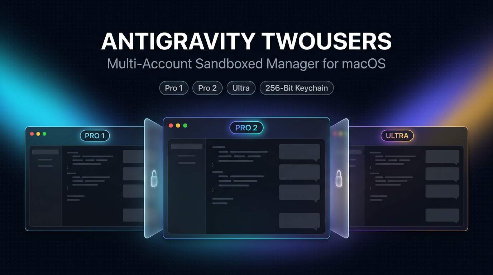
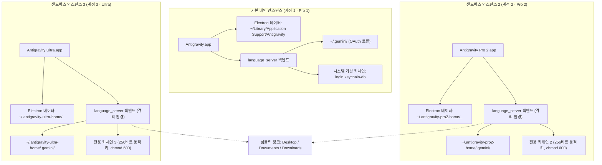

<p align="center">
  
</p>

<h1 align="center">Antigravity TwoUsers</h1>

<p align="center">
  <b>macOS용 Google Antigravity 듀얼·트리플 완전 물리 샌드박스 매니저 (Pro 1 · Pro 2 · Ultra)</b><br>
  5시간 제한 극복 · 256비트 동적 키체인 · 스마트 OAuth 콜백 라우터 · 다중 창 동시 실행
</p>

<p align="center">
  <a href="../README.md">简体中文</a> ·
  <a href="README.en.md">English</a> ·
  <a href="README.ja.md">日本語</a> ·
  <b>한국어</b> ·
  <a href="README.es.md">Español</a> ·
  <a href="README.fr.md">Français</a> ·
  <a href="README.pt.md">Português</a>
</p>

<p align="center">
  <a href="https://apple.com"></a>
  
  
  
  
  <a href="../LICENSE"></a>
</p>

<p align="center">
  <a href="#-핵심-특장점">✨ 특장점</a> •
  <a href="#-방식-비교">⚖️ 비교</a> •
  <a href="#-물리-샌드박스-격리-아키텍처">🏗️ 아키텍처</a> •
  <a href="#-스마트-oauth-콜백-라우터">🧭 스마트 라우터</a> •
  <a href="#-빠른-시작">🚀 빠른 시작</a> •
  <a href="#-멀티-agent-릴레이-워크플로우">🔄 릴레이 협업</a> •
  <a href="#-보안-및-프라이버시">🛡️ 보안</a> •
  <a href="#-자주-묻는-질문-faq">❓ FAQ</a>
</p>

---

## ✨ 핵심 특장점

<table>
  <tr>
    <td width="33%" valign="top">
      <h3>🧊 100% 물리 샌드박스 격리</h3>
      <code>$HOME</code>과 Electron <code>--user-data-dir</code>를 동시 리다이렉션하여 UI 캐시와 Go <code>language_server</code> 백엔드의 계정 혼선을 원천 차단합니다.
    </td>
    <td width="33%" valign="top">
      <h3>🧭 스마트 OAuth 콜백 라우터</h3>
      네이티브 Swift <b>Antigravity Router</b>가 브라우저 인증 후 <code>antigravity://</code> 클릭 시 인증을 시작한 Pro 2 / Ultra 창으로 정확히 복귀시킵니다.
    </td>
    <td width="33%" valign="top">
      <h3>🔐 256비트 동적 암호화 키체인</h3>
      설치 시 <code>openssl rand -hex 32</code>로 인스턴스별 고유 256비트 랜덤 비밀번호를 생성해 <code>chmod 600</code>으로 보호합니다. 하드코딩 비밀번호 제로.
    </td>
  </tr>
  <tr>
    <td width="33%" valign="top">
      <h3>♾️ 무중단 토큰 자동 갱신</h3>
      macOS CLI 키체인의 5분 유휴 자동 잠금을 해제하여 1시간마다 수행되는 Google OAuth 갱신이 24시간 끊김 없이 작동합니다.
    </td>
    <td width="33%" valign="top">
      <h3>🚀 듀얼·트리플 동시 실행</h3>
      <b>Pro 2</b>와 <b>Ultra(3번째 인스턴스)</b> 원클릭 설치 + Dock 네이티브 통합 + 바탕화면·문서·다운로드 자동 심볼릭 링크.
    </td>
    <td width="33%" valign="top">
      <h3>🧹 무침습 &amp; 깔끔한 복원</h3>
      원본 바이너리를 공유해 용량을 아끼며 호스트 기본 키체인을 건드리지 않고, 제거 시 기본 Antigravity는 100% 원상태를 유지합니다.
    </td>
  </tr>
</table>

---

## ⚖️ 방식 비교

| 비교 항목 | 기본 단일 실행 | `--user-data-dir`만 변경 | **Antigravity TwoUsers** |
| :--- | :---: | :---: | :---: |
| 다중 계정 동시 실행 (2중 / 3중) | ❌ | ❌ (백엔드 세션 충돌) | ✅ **Pro 1 + Pro 2 + Ultra 지원** |
| 브라우저 인증 후 정확한 인스턴스 복귀 | — | ❌ (항상 메인 창으로 이동) | ✅ **Swift 스마트 URL 라우터** |
| 로그아웃 없이 계정 전환 | ❌ | ❌ | ✅ **계정별 로그인 상태 영구 유지** |
| 백그라운드 OAuth 토큰 자동 갱신 | ✅ | ❌ (키체인 잠금 오류) | ✅ **타임아웃 해제로 24시간 안정 갱신** |
| 비밀번호 보안 (하드코딩 없음) | ✅ | — | ✅ **256비트 동적 비밀키 + `chmod 600`** |
| 호스트 기본 키체인 미변경 | ✅ | ⚠️ | ✅ **하위 프로세스 샌드박스 한정 격리** |

---

## 🏗️ 물리 샌드박스 격리 아키텍처

<p align="center">
  
</p>

<details>
<summary><b>📐 Mermaid 프로세스 및 데이터 흐름도 펼치기</b></summary>



</details>

---

## 🧭 스마트 OAuth 콜백 라우터

<p align="center">
  
</p>

macOS는 기본적으로 `antigravity://` 프로토콜을 메인 앱에 고정하기 때문에, Pro 2나 Ultra에서 로그인 후 브라우저의 「Antigravity 열기」를 클릭하면 메인 창이 열립니다.

경량 네이티브 Swift 앱 **`Antigravity Router.app`**(유휴 메모리 0MB)이 **이중 신호 정밀 판별**로 이를 완벽히 해결합니다:
1. **신호 1 · 인증 기록 타임스탬프**: 최근 15초 내 전용 키체인에 OAuth 토큰이 기록된 샌드박스 인스턴스를 최우선 식별;
2. **신호 2 · 윈도우 Z-Order**: 권한 팝업 없는 `CGWindowListCopyWindowInfo`로 브라우저 바로 아래에 있던 인스턴스 PID 탐색;
3. **정밀 활성화 및 전달**: 해당 **Primary / Pro 2 / Ultra** 창을 즉시 전면 활성화하며 딥링크 페이로드도 해당 PID로 직접 전달합니다.

---

## 🚀 빠른 시작

```bash
git clone https://github.com/Kongxijun88/antigravity-twousers.git
cd antigravity-twousers

# 인스턴스 2 (Antigravity Pro 2) 설치
chmod +x install.sh && ./install.sh

# 인스턴스 3 (Antigravity Ultra) 설치 (선택)
chmod +x install-ultra.sh && ./install-ultra.sh

# 스마트 OAuth 콜백 라우터 설치 (권장)
chmod +x install-router.sh && ./install-router.sh
```

> 상태 진단: `"/Applications/Antigravity Router.app/Contents/MacOS/AntigravityRouter" --status`

---

## 📂 프로젝트 구조

```text
antigravity-twousers/
├── install.sh                  # 인스턴스 2 (Pro 2) 원클릭 설치
├── uninstall.sh                # 인스턴스 2 안전 제거
├── install-ultra.sh            # 인스턴스 3 (Ultra) 원클릭 설치
├── uninstall-ultra.sh          # 인스턴스 3 안전 제거
├── install-router.sh           # 네이티브 Swift 스마트 URL 라우터 설치
├── uninstall-router.sh         # 라우터 제거 및 공식 핸들러 복원
├── router/
│   └── AntigravityRouter.swift # 이중 신호 macOS URL 라우터 소스
├── scripts/
│   ├── launch.sh               # 인스턴스 2 CLI 실행기
│   └── launch-ultra.sh         # 인스턴스 3 CLI 실행기
├── assets/                     # 배너·아키텍처·라우터·릴레이 그래픽
├── docs/                       # 다국어 문서 (EN / JA / KO / ES / FR / PT)
└── LICENSE                     # MIT License
```

---

## 🔄 멀티 Agent 릴레이 워크플로우

<p align="center">
  
</p>

| 인스턴스 | 권장 역할 |
| :--- | :--- |
| **Antigravity (Pro 1)** | 일상 기능 개발, UI 다듬기, 단위 테스트, 일반 버그 수정 |
| **Antigravity Pro 2** | Pro 1의 5시간 제한 도달 시 즉시 투입되는 릴레이 백업 |
| **Antigravity Ultra** | 대규모 아키텍처 리팩토링, 고난도 디버깅, 심층 추론 작업 |

---

## 🛡️ 보안 및 프라이버시

| 보안 영역 | 구현 방식 |
| :--- | :--- |
| **하드코딩 비밀번호 제로** | `openssl rand -hex 32`로 기기별 고유 256비트 난수 비밀번호 동적 생성 |
| **엄격한 파일 권한** | `.keychain_secret` 및 `login.keychain-db` 모두 `chmod 600` 강제 적용 |
| **호스트 키체인 무영향** | 하위 프로세스 내 `export HOME`으로만 격리, 시스템 기본 키체인 미변경 |
| **100% 로컬 투명 코드** | 텔레메트리나 외부 통신 없는 순수 오픈소스 Swift / Bash / Python |

---

## 🗑️ 안전한 제거

```bash
./uninstall.sh          # 인스턴스 2 제거
./uninstall-ultra.sh    # 인스턴스 3 제거
./uninstall-router.sh   # 라우터 제거 및 기본 핸들러 복원
```

---

## ❓ 자주 묻는 질문 (FAQ)

<details>
<summary><b>Q1: 추가 인스턴스에서 바탕화면이나 다운로드 폴더의 프로젝트를 열 수 있나요?</b></summary>
<br>
네. 설치 스크립트가 각 샌드박스 내부에 <code>~/Desktop</code>, <code>~/Documents</code>, <code>~/Downloads</code> 심볼릭 링크를 자동 생성합니다.
</details>

<details>
<summary><b>Q2: Mac을 재부팅하면 계정이 섞이거나 로그아웃되나요?</b></summary>
<br>
<b>전혀 그렇지 않습니다.</b> 각 인스턴스의 인증 정보는 완전히 분리된 홈 디렉토리와 전용 키체인에 영구 저장됩니다.
</details>

<details>
<summary><b>Q3: 인증 후 브라우저가 "Antigravity Router 열기"를 묻는 것은 정상인가요?</b></summary>
<br>
<b>정상입니다!</b> "항상 허용"을 체크하면 이후부터는 로그인을 시작한 정확한 인스턴스 창으로 자동 복귀합니다.
</details>

<details>
<summary><b>Q4: 3개 인스턴스를 동시에 실행해도 Mac 메모리가 충분할까요?</b></summary>
<br>
<b>충분합니다.</b> 실행 바이너리는 하나로 공유되며 3개 동시 실행 시 합계 약 2GB~2.5GB만 사용하므로 16GB 이상 Apple Silicon Mac에서 매우 쾌적합니다.
</details>

---

## 📄 라이선스

[MIT License](../LICENSE)에 따라 배포됩니다. 도움이 되셨다면 **Star ⭐️**를 눌러 응원해주세요!
