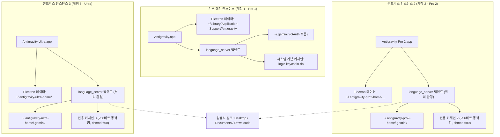

<p align="center">
  
</p>

<h1 align="center">Antigravity TwoUsers</h1>

<p align="center">
  <b>macOS용 Google Antigravity 듀얼·트리플 완전 물리 샌드박스 매니저 (Pro 1 · Pro 2 · Ultra)</b><br>
  5시간 사용량 제한을 극복하고 256비트 동적 키체인 보호 아래 여러 계정을 충돌 없이 동시에 실행하세요.
</p>

<p align="center">
  <a href="../README.md">简体中文</a> ·
  <a href="README.en.md">English</a> ·
  <a href="README.ja.md">日本語</a> ·
  <b>한국어</b> ·
  <a href="README.es.md">Español</a> ·
  <a href="README.fr.md">Français</a> ·
  <a href="README.pt.md">Português</a>
</p>

<p align="center">
  <a href="https://apple.com"></a>
  
  
  
  <a href="../LICENSE"></a>
</p>

<p align="center">
  <a href="#-핵심-특장점">✨ 특장점</a> •
  <a href="#-방식-비교">⚖️ 비교</a> •
  <a href="#-물리-샌드박스-격리-아키텍처">🏗️ 아키텍처</a> •
  <a href="#-빠른-시작">🚀 빠른 시작</a> •
  <a href="#-멀티-agent-릴레이-워크플로우">🔄 릴레이 협업</a> •
  <a href="#-보안-및-프라이버시">🛡️ 보안</a> •
  <a href="#-자주-묻는-질문-faq">❓ FAQ</a>
</p>

---

## ✨ 핵심 특장점

<table>
  <tr>
    <td width="33%" valign="top">
      <h3>🧊 100% 물리 샌드박스 격리</h3>
      <code>$HOME</code>과 Electron <code>--user-data-dir</code>를 동시 리다이렉션하여 UI 캐시와 Go <code>language_server</code> 백엔드의 계정 혼선을 원천 차단합니다.
    </td>
    <td width="33%" valign="top">
      <h3>🔐 256비트 동적 암호화 키체인</h3>
      설치 시 <code>openssl rand -hex 32</code>로 인스턴스별 고유 256비트 랜덤 비밀번호를 생성해 <code>chmod 600</code>으로 보호합니다. 하드코딩 비밀번호 제로.
    </td>
    <td width="33%" valign="top">
      <h3>♾️ 무중단 토큰 자동 갱신</h3>
      macOS CLI 키체인의 5분 유휴 자동 잠금을 해제하여 1시간마다 수행되는 Google OAuth 갱신이 24시간 끊김 없이 작동합니다.
    </td>
  </tr>
  <tr>
    <td width="33%" valign="top">
      <h3>🚀 듀얼·트리플 동시 실행</h3>
      <b>Pro 2</b>와 <b>Ultra(3번째 인스턴스)</b> 원클릭 스크립트를 기본 제공하여 최대 3개 계정을 나란히 띄워 동시에 사용할 수 있습니다.
    </td>
    <td width="33%" valign="top">
      <h3>🖥️ 네이티브 Dock 통합</h3>
      공식 아이콘이 적용된 독립 <code>.app</code> 런처를 빌드해 Dock에 자동 배치하며, 바탕화면·문서·다운로드 폴더를 자동 연결합니다.
    </td>
    <td width="33%" valign="top">
      <h3>🧹 무침습 &amp; 깔끔한 복원</h3>
      원본 앱 바이너리를 공유해 용량을 아끼고 호스트 기본 키체인을 건드리지 않으며, 제거 시 기본 Antigravity는 100% 원상태로 유지됩니다.
    </td>
  </tr>
</table>

---

## ⚖️ 방식 비교

| 비교 항목 | 기본 단일 실행 | `--user-data-dir`만 변경 | **Antigravity TwoUsers** |
| :--- | :---: | :---: | :---: |
| 다중 계정 동시 실행 (2중 / 3중) | ❌ | ❌ (백엔드 세션 충돌) | ✅ **Pro 1 + Pro 2 + Ultra 지원** |
| 로그아웃 없이 계정 전환 | ❌ | ❌ | ✅ **계정별 로그인 상태 영구 유지** |
| 백그라운드 OAuth 토큰 자동 갱신 | ✅ | ❌ (키체인 잠금 오류) | ✅ **타임아웃 해제로 24시간 안정 갱신** |
| 비밀번호 보안 (하드코딩 없음) | ✅ | — | ✅ **256비트 동적 비밀키 + `chmod 600`** |
| 호스트 기본 키체인 미변경 | ✅ | ⚠️ | ✅ **하위 프로세스 샌드박스 한정 격리** |
| 바탕화면 및 로컬 Git 저장소 접근 | ✅ | ✅ | ✅ **심볼릭 링크 자동 구성** |

---

## 🏗️ 물리 샌드박스 격리 아키텍처

<p align="center">
  
</p>

<details>
<summary><b>📐 Mermaid 프로세스 및 데이터 흐름도 펼치기</b></summary>



</details>

### 🔬 해결한 3대 핵심 기술 난제

1. **자동 계정 혼선 해결**: `--user-data-dir`만 바꾸면 Go 백엔드가 여전히 `$HOME/.gemini/`를 읽습니다. `$HOME`과 `--user-data-dir`를 동시 격리해 완벽히 분리했습니다.
2. **OAuth 콜백 충돌 방지**: 임시 로컬 Loopback HTTP 포트를 각 격리 컨텍스트에 독립 바인딩하여 *"Further action is required"* 오류를 없앴습니다.
3. **수 시간 후 모델 비활성화 근본 해결**: CLI 키체인의 300초 유휴 잠금과 절전 잠금을 `security set-keychain-settings`로 해제하고 256비트 동적 비밀키와 결합해 24시간 무중단 토큰 갱신을 보장합니다.

---

## 🚀 빠른 시작

### 사전 요구 사항
* macOS 14+ (Apple Silicon M1–M4 및 Intel 지원)
* `/Applications/Antigravity.app`에 공식 클라이언트 설치 완료

### 1. 저장소 클론
```bash
git clone https://github.com/Kongxijun88/antigravity-twousers.git
cd antigravity-twousers
```

### 2. 두 번째 인스턴스(`Antigravity Pro 2`) 설치
```bash
chmod +x install.sh
./install.sh
```

### 3. 세 번째 인스턴스(`Antigravity Ultra`) 설치 (선택)
```bash
chmod +x install-ultra.sh
./install-ultra.sh
```

### 📋 인스턴스 구성 요약

| 인스턴스 | 앱 런처 (Dock / Applications) | 격리 샌드박스 홈 | CLI 디버그 실행 |
| :--- | :--- | :--- | :--- |
| **메인 (Pro 1)** | `/Applications/Antigravity.app` | `~/.gemini/` (시스템 기본) | — |
| **인스턴스 2 (Pro 2)** | `/Applications/Antigravity Pro 2.app` | `~/.antigravity-pro2-home/` | `./scripts/launch.sh` |
| **인스턴스 3 (Ultra)** | `/Applications/Antigravity Ultra.app` | `~/.antigravity-ultra-home/` | `./scripts/launch-ultra.sh` |

---

## 📂 프로젝트 구조

```text
antigravity-twousers/
├── install.sh                 # 인스턴스 2 (Pro 2) 원클릭 설치 스크립트
├── uninstall.sh               # 인스턴스 2 안전 제거 스크립트
├── install-ultra.sh           # 인스턴스 3 (Ultra) 원클릭 설치 스크립트
├── uninstall-ultra.sh         # 인스턴스 3 안전 제거 스크립트
├── scripts/
│   ├── launch.sh              # 인스턴스 2 CLI 단독 실행기
│   └── launch-ultra.sh        # 인스턴스 3 CLI 단독 실행기
├── assets/
│   ├── banner.png             # 저장소 히어로 배너
│   └── architecture.png       # 샌드박스 격리 아키텍처 인포그래픽
├── docs/                      # 다국어 문서 (EN / JA / KO / ES / FR / PT)
└── LICENSE                    # MIT License
```

---

## 🔄 멀티 Agent 릴레이 워크플로우

다중 계정(**Pro×2 + Ultra×1**)을 극대화하는 **난이도 분배 + 컨텍스트 유지 릴레이 프로토콜**:

| 인스턴스 | 권장 역할 |
| :--- | :--- |
| **Antigravity (Pro 1)** | 일상 기능 개발, UI 다듬기, 단위 테스트, 일반 버그 수정 |
| **Antigravity Pro 2** | Pro 1의 5시간 제한 도달 시 즉시 투입되는 릴레이 백업 |
| **Antigravity Ultra** | 대규모 아키텍처 리팩토링, 고난도 디버깅, 심층 추론 작업 |

### 2단계 무손실 인수인계

**1단계 — 작업 저장 및 전달 (현재 창):**
```text
곧 다른 계정으로 전환해 이 프로젝트를 이어갈 예정입니다. 현재 수정 사항을 모두 저장해 git commit으로 기록하고, 완료 내역·핵심 설계·다음 할 일을 정리한 HANDOVER.md를 루트에 생성한 뒤 다음 Agent에게 전달할 짧은 브리핑 문구를 작성해주세요.
```

**2단계 — 즉시 이어받기 (다음 Pro 2 / Ultra 창):**
동일한 프로젝트 폴더를 열어 붙여넣기:
```text
프로젝트 루트의 HANDOVER.md와 최신 git commit을 확인해 현재 진행 상황을 파악한 뒤 다음 할 일을 이어서 진행해주세요.
```

---

## 🛡️ 보안 및 프라이버시

| 보안 영역 | 구현 방식 |
| :--- | :--- |
| **하드코딩 비밀번호 제로** | 설치 시 로컬에서 `openssl rand -hex 32`로 고유한 256비트 난수 비밀번호 동적 생성 |
| **엄격한 파일 권한** | `.keychain_secret` 및 `login.keychain-db` 파일 모두 `chmod 600` (소유자 전용) 강제 적용 |
| **호스트 키체인 무영향** | 하위 프로세스 내 `export HOME`으로만 격리하며 시스템 기본 키체인 설정을 절대 변경하지 않음 |
| **100% 로컬 투명 코드** | 텔레메트리나 외부 통신이 전혀 없는 순수 오픈소스 Bash / Python 스크립트 |

---

## 🗑️ 안전한 제거

```bash
# 인스턴스 2 (Antigravity Pro 2) 제거
./uninstall.sh

# 인스턴스 3 (Antigravity Ultra) 제거
./uninstall-ultra.sh
```

실행 중인 해당 프로세스를 종료하고 `.app` 및 Dock 항목을 제거하며, 샌드박스 데이터 삭제 또는 잠금 보관 여부를 묻습니다. **기존 Antigravity 앱과 기본 계정은 100% 안전하게 유지됩니다.**

---

## ❓ 자주 묻는 질문 (FAQ)

<details>
<summary><b>Q1: 추가 인스턴스에서 바탕화면이나 다운로드 폴더의 프로젝트를 열 수 있나요?</b></summary>
<br>
네. 설치 스크립트가 각 샌드박스 내부에 <code>~/Desktop</code>, <code>~/Documents</code>, <code>~/Downloads</code> 심볼릭 링크를 자동 생성합니다.
</details>

<details>
<summary><b>Q2: Mac을 재부팅하면 계정이 섞이거나 로그아웃되나요?</b></summary>
<br>
<b>전혀 그렇지 않습니다.</b> 각 인스턴스의 인증 정보는 완전히 분리된 홈 디렉토리와 전용 키체인에 영구 저장됩니다.
</details>

<details>
<summary><b>Q3: 3개 인스턴스를 동시에 실행해도 Mac 메모리가 충분할까요?</b></summary>
<br>
<b>충분합니다.</b> 실행 바이너리는 하나로 공유되며 인스턴스당 약 500MB~800MB(3개 합계 약 2GB~2.5GB)만 사용하므로 16GB 이상 Apple Silicon Mac에서 쾌적하게 동작합니다.
</details>

<details>
<summary><b>Q4: 여러 인스턴스에서 같은 Git 저장소를 동시에 열 수 있나요?</b></summary>
<br>
<b>가능합니다.</b> 동시 편집 충돌을 피하기 위해 위의 멀티 Agent 릴레이 워크플로우에 따라 번갈아 작업하는 것을 권장합니다.
</details>

<details>
<summary><b>Q5: 확장 프로그램과 테마 설정은 공유되나요, 독립적인가요?</b></summary>
<br>
<b>완전히 독립적입니다.</b> 팁: 각 인스턴스에 서로 다른 컬러 테마를 지정해 두면 Pro 1 / Pro 2 / Ultra 창을 한눈에 구분할 수 있습니다!
</details>

---

## 📄 라이선스

[MIT License](../LICENSE)에 따라 배포됩니다. 도움이 되셨다면 **Star ⭐️**를 눌러 응원해주세요!
