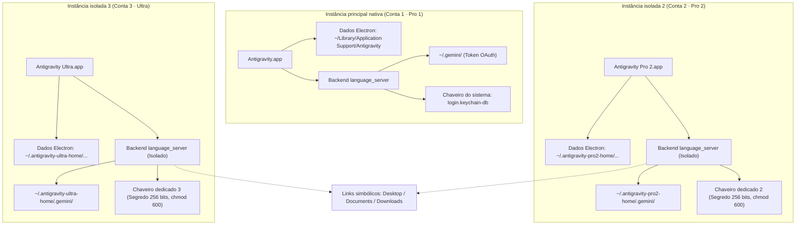

<p align="center">
  
</p>

<h1 align="center">Antigravity TwoUsers</h1>

<p align="center">
  <b>Gerenciador de Instâncias Duplas e Triplas com Sandbox Físico para Google Antigravity no macOS (Pro 1 · Pro 2 · Ultra)</b><br>
  Contorne os limites de 5 horas com zero conflito de contas, chaveiro dinâmico de 256 bits e operação paralela real.
</p>

<p align="center">
  <a href="../README.md">简体中文</a> ·
  <a href="README.en.md">English</a> ·
  <a href="README.ja.md">日本語</a> ·
  <a href="README.ko.md">한국어</a> ·
  <a href="README.es.md">Español</a> ·
  <a href="README.fr.md">Français</a> ·
  <b>Português</b>
</p>

<p align="center">
  <a href="https://apple.com"></a>
  
  
  
  <a href="../LICENSE"></a>
</p>

<p align="center">
  <a href="#-destaques">✨ Destaques</a> •
  <a href="#-comparativo">⚖️ Comparativo</a> •
  <a href="#-arquitetura-de-sandbox-físico">🏗️ Arquitetura</a> •
  <a href="#-instalação-rápida">🚀 Instalação</a> •
  <a href="#-protocolo-de-revezamento-multi-agente">🔄 Revezamento</a> •
  <a href="#-segurança-e-privacidade">🛡️ Segurança</a> •
  <a href="#-perguntas-frequentes-faq">❓ FAQ</a>
</p>

---

## ✨ Destaques

<table>
  <tr>
    <td width="33%" valign="top">
      <h3>🧊 Sandbox Físico 100% Isolado</h3>
      Redireciona tanto <code>$HOME</code> quanto <code>--user-data-dir</code> do Electron, separando completamente o cache de interface e o backend Go <code>language_server</code>.
    </td>
    <td width="33%" valign="top">
      <h3>🔐 Chaveiro Dinâmico de 256 Bits</h3>
      Gera localmente uma senha criptográfica única por instalação via <code>openssl rand -hex 32</code> com permissão <code>chmod 600</code>. Zero senhas fixas no código.
    </td>
    <td width="33%" valign="top">
      <h3>♾️ Renovação Silenciosa 24/7</h3>
      Elimina o bloqueio de 5 minutos por inatividade do Chaveiro CLI no macOS para que renovações OAuth de hora em hora nunca falhem.
    </td>
  </tr>
  <tr>
    <td width="33%" valign="top">
      <h3>🚀 Instâncias Duplas e Triplas</h3>
      Instaladores em um clique para <b>Pro 2</b> e <b>Ultra (Instância 3)</b>: rode até 3 contas independentes lado a lado.
    </td>
    <td width="33%" valign="top">
      <h3>🖥️ Integração Nativa ao Dock</h3>
      Compila apps nativos <code>.app</code> com ícones oficiais fixados no Dock e cria links automáticos para Mesa, Documentos e Downloads.
    </td>
    <td width="33%" valign="top">
      <h3>🧹 Sem Intrusão e Reversível</h3>
      Compartilha o binário oficial sem desperdiçar disco, nunca altera seu Chaveiro padrão e mantém o app original 100% intacto ao desinstalar.
    </td>
  </tr>
</table>

---

## ⚖️ Comparativo

| Recurso | App Nativo Único | Apenas `--user-data-dir` | **Antigravity TwoUsers** |
| :--- | :---: | :---: | :---: |
| Janelas paralelas multi-conta (2× / 3×) | ❌ | ❌ (Colisão no backend) | ✅ **Pro 1 + Pro 2 + Ultra** |
| Trocar de conta sem fazer logout | ❌ | ❌ | ✅ **Sessões isoladas permanentes** |
| Renovação automática de tokens OAuth | ✅ | ❌ (Chaveiro trava) | ✅ **Sem tempo limite, estável 24/7** |
| Zero credenciais escritas no código | ✅ | — | ✅ **Segredo aleatório 256 bits (`chmod 600`)** |
| Chaveiro padrão do sistema intacto | ✅ | ⚠️ | ✅ **Isolamento restrito ao subprocesso** |
| Acesso direto a repositórios locais | ✅ | ✅ | ✅ **Links simbólicos automáticos** |

---

## 🏗️ Arquitetura de Sandbox Físico

<p align="center">
  
</p>

<details>
<summary><b>📐 Expandir Diagrama Mermaid de Processos e Fluxo de Dados</b></summary>



</details>

### 🔬 3 Desafios Técnicos Resolvidos

1. **Zero Mistura de Sessões**: `--user-data-dir` redireciona apenas o Electron enquanto o `language_server` continua lendo `$HOME/.gemini/`. Redirecionar ambos garante isolamento completo.
2. **Callbacks OAuth Sem Conflito**: Cada instância escuta em sua própria porta local Loopback HTTP em contexto limpo, eliminando erros de *"Further action is required"*.
3. **Fim das Quedas Após 1 Hora**: Desativar o bloqueio por inatividade/repouso via `security set-keychain-settings` com segredo dinâmico de 256 bits assegura renovação contínua.

---

## 🚀 Instalação Rápida

### Pré-requisitos
* macOS 14+ (Apple Silicon M1–M4 ou Intel)
* Google Antigravity oficial instalado em `/Applications/Antigravity.app`

### 1. Clonar o Repositório
```bash
git clone https://github.com/Kongxijun88/antigravity-twousers.git
cd antigravity-twousers
```

### 2. Instalar Instância 2 (`Antigravity Pro 2`)
```bash
chmod +x install.sh
./install.sh
```

### 3. Instalar Instância 3 (`Antigravity Ultra`, Opcional)
```bash
chmod +x install-ultra.sh
./install-ultra.sh
```

### 📋 Resumo das Instâncias

| Instância | Aplicativo (Dock / Aplicativos) | Diretório Sandbox | Executável CLI |
| :--- | :--- | :--- | :--- |
| **Principal (Pro 1)** | `/Applications/Antigravity.app` | `~/.gemini/` (Padrão) | — |
| **Instância 2 (Pro 2)** | `/Applications/Antigravity Pro 2.app` | `~/.antigravity-pro2-home/` | `./scripts/launch.sh` |
| **Instância 3 (Ultra)** | `/Applications/Antigravity Ultra.app` | `~/.antigravity-ultra-home/` | `./scripts/launch-ultra.sh` |

---

## 📂 Estrutura do Projeto

```text
antigravity-twousers/
├── install.sh                 # Instalador em um clique para Instância 2 (Pro 2)
├── uninstall.sh               # Desinstalador limpo para Instância 2
├── install-ultra.sh           # Instalador em um clique para Instância 3 (Ultra)
├── uninstall-ultra.sh         # Desinstalador limpo para Instância 3
├── scripts/
│   ├── launch.sh              # Executor CLI independente (Instância 2)
│   └── launch-ultra.sh        # Executor CLI independente (Instância 3)
├── assets/
│   ├── banner.png             # Capa principal do repositório
│   └── architecture.png       # Infográfico de arquitetura sandbox
├── docs/                      # Documentação multilíngue (EN / JA / KO / ES / FR / PT)
└── LICENSE                    # Licença MIT
```

---

## 🔄 Protocolo de Revezamento Multi-Agente

Aproveite ao máximo **2× Pro + 1× Ultra** combinando **divisão por complexidade + revezamento com contexto**:

| Instância | Papel Recomendado |
| :--- | :--- |
| **Antigravity (Pro 1)** | Desenvolvimento diário, ajustes de UI, testes unitários e correções rotineiras |
| **Antigravity Pro 2** | Revezamento imediato quando Pro 1 atinge a janela limite de 5 horas |
| **Antigravity Ultra** | Refatorações complexas, depuração profunda e arquitetura de sistemas |

### Revezamento em 2 Passos

**Passo 1 — Salvar e passar o bastão (Janela ativa):**
```text
Vou alternar em breve para outra conta para continuar este projeto. Salve todas as alterações, faça um git commit limpo, gere um arquivo HANDOVER.md resumindo o que foi concluído, decisões-chave e próximas tarefas, e escreva uma instrução curta para eu colar ao próximo agente.
```

**Passo 2 — Retomar imediatamente (Janela Pro 2 / Ultra):**
Abra a mesma pasta via `File -> Open Folder` e cole:
```text
Leia HANDOVER.md e o último git commit para entender o estado atual do projeto e continue com a próxima tarefa pendente.
```

---

## 🛡️ Segurança e Privacidade

| Controle | Implementação |
| :--- | :--- |
| **Zero Senhas Fixas** | Cada instalação gera localmente uma senha aleatória de 256 bits via `openssl rand -hex 32` |
| **Permissões Estritas** | Tanto `.keychain_secret` quanto `login.keychain-db` são protegidos com `chmod 600` (apenas proprietário) |
| **Chaveiro do Sistema Intacto** | O isolamento ocorre via `export HOME` no subprocesso, sem alterar o chaveiro global do macOS |
| **100% Local e Auditável** | Scripts transparentes em Bash e Python, sem telemetria nem chamadas externas |

---

## 🗑️ Desinstalação Limpa

```bash
# Desinstalar Instância 2 (Antigravity Pro 2)
./uninstall.sh

# Desinstalar Instância 3 (Antigravity Ultra)
./uninstall-ultra.sh
```

Encerra processos ativos da instância, remove o `.app` e o ícone do Dock, e permite optar entre apagar ou manter (travados) os dados da sandbox. **O Antigravity original permanece 100% intacto.**

---

## ❓ Perguntas Frequentes (FAQ)

<details>
<summary><b>P1: Posso abrir projetos da Mesa ou Downloads a partir das instâncias extras?</b></summary>
<br>
Sim. Cada sandbox cria links simbólicos automáticos para <code>~/Desktop</code>, <code>~/Documents</code> e <code>~/Downloads</code>.
</details>

<details>
<summary><b>P2: Reiniciar o Mac pode misturar contas ou deslogar as sessões?</b></summary>
<br>
<b>Nunca.</b> Cada instância armazena suas credenciais separadamente em sua própria sandbox e chaveiro dedicado.
</details>

<details>
<summary><b>P3: Meu Mac aguenta rodar as 3 instâncias simultaneamente?</b></summary>
<br>
<b>Sem problemas.</b> Todas compartilham o mesmo binário em disco e consomem ~500MB–800MB de RAM cada (~2GB–2.5GB no total), rodando com fluidez em qualquer Mac Apple Silicon de 16GB+.
</details>

<details>
<summary><b>P4: Várias instâncias podem abrir o mesmo repositório Git ao mesmo tempo?</b></summary>
<br>
<b>Sim.</b> Siga o Protocolo de Revezamento Multi-Agente acima para evitar edições concorrentes no mesmo arquivo não salvo.
</details>

<details>
<summary><b>P5: Extensões e temas são compartilhados ou independentes?</b></summary>
<br>
<b>Totalmente independentes.</b> Dica: escolha um tema de cor diferente para cada instância para diferenciar Pro 1, Pro 2 e Ultra num piscar de olhos!
</details>

---

## 📄 Licença

Disponibilizado sob a [Licença MIT](../LICENSE). Se este projeto ajudou você, deixe uma **Star ⭐️**!
