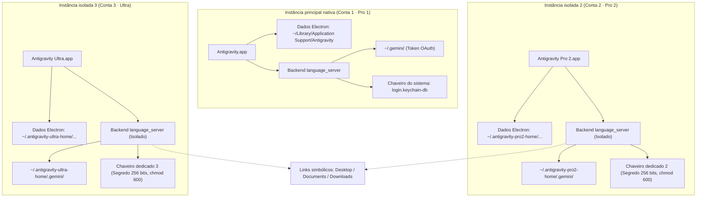
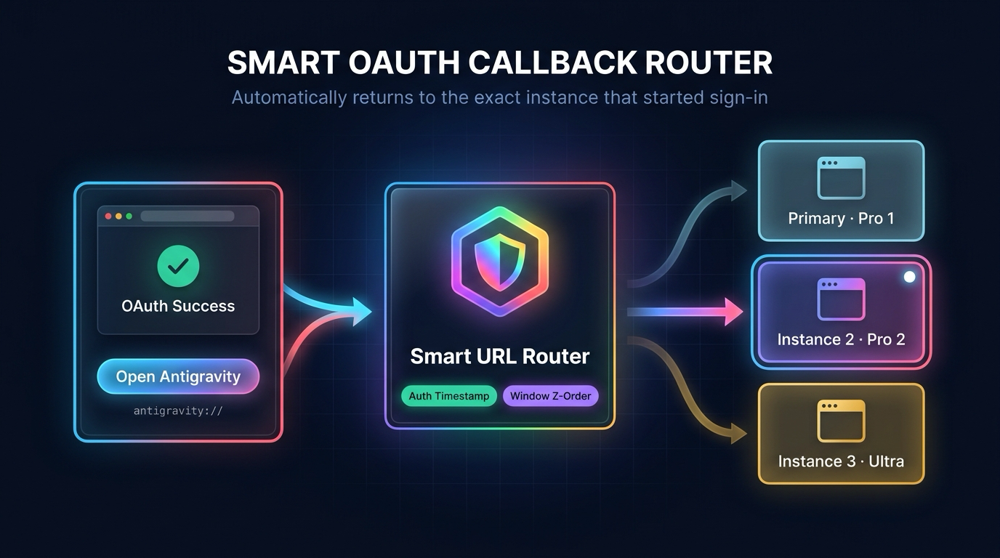

<p align="center">
  
</p>

<h1 align="center">Antigravity TwoUsers</h1>

<p align="center">
  <b>Gerenciador de Instâncias Duplas e Triplas com Sandbox Físico para Google Antigravity no macOS (Pro 1 · Pro 2 · Ultra)</b><br>
  Contorne os limites de 5h · Chaveiro Dinâmico de 256 Bits · Roteador Inteligente OAuth · Operação Paralela Real
</p>

<p align="center">
  <a href="../README.md">简体中文</a> ·
  <a href="README.en.md">English</a> ·
  <a href="README.ja.md">日本語</a> ·
  <a href="README.ko.md">한국어</a> ·
  <a href="README.es.md">Español</a> ·
  <a href="README.fr.md">Français</a> ·
  <b>Português</b>
</p>

<p align="center">
  <a href="https://apple.com"></a>
  
  
  
  
  <a href="../LICENSE"></a>
</p>

<p align="center">
  <a href="#-destaques">✨ Destaques</a> •
  <a href="#-comparativo">⚖️ Comparativo</a> •
  <a href="#-arquitetura-de-sandbox-físico">🏗️ Arquitetura</a> •
  <a href="#-roteador-inteligente-de-callbacks-oauth">🧭 Roteador OAuth</a> •
  <a href="#-instalação-rápida">🚀 Instalação</a> •
  <a href="#-protocolo-de-revezamento-multi-agente">🔄 Revezamento</a> •
  <a href="#-segurança-e-privacidade">🛡️ Segurança</a> •
  <a href="#-perguntas-frequentes-faq">❓ FAQ</a>
</p>

---

## ✨ Destaques

<table>
  <tr>
    <td width="33%" valign="top">
      <h3>🧊 Sandbox Físico 100% Isolado</h3>
      Redireciona tanto <code>$HOME</code> quanto <code>--user-data-dir</code> do Electron, separando completamente o cache de interface e o backend Go <code>language_server</code>.
    </td>
    <td width="33%" valign="top">
      <h3>🧭 Roteador Inteligente OAuth</h3>
      <b>Antigravity Router</b> em Swift nativo intercepta <code>antigravity://</code> após o login no navegador e retorna exatamente para a janela Pro 2 / Ultra de origem.
    </td>
    <td width="33%" valign="top">
      <h3>🔐 Chaveiro Dinâmico de 256 Bits</h3>
      Gera localmente uma senha criptográfica única por instalação via <code>openssl rand -hex 32</code> com permissão <code>chmod 600</code>. Zero senhas fixas.
    </td>
  </tr>
  <tr>
    <td width="33%" valign="top">
      <h3>♾️ Renovação Silenciosa 24/7</h3>
      Elimina o bloqueio de 5 minutos do Chaveiro CLI no macOS para que renovações OAuth de hora em hora nunca falhem.
    </td>
    <td width="33%" valign="top">
      <h3>🚀 Instâncias Duplas e Triplas</h3>
      Instaladores em um clique para <b>Pro 2</b> e <b>Ultra (Instância 3)</b> com integração nativa ao Dock e links automáticos para seus arquivos.
    </td>
    <td width="33%" valign="top">
      <h3>🧹 Sem Intrusão e Reversível</h3>
      Compartilha o binário oficial sem desperdiçar disco, nunca altera seu Chaveiro padrão e mantém o app original 100% intacto.
    </td>
  </tr>
</table>

---

## ⚖️ Comparativo

| Recurso | App Nativo Único | Apenas `--user-data-dir` | **Antigravity TwoUsers** |
| :--- | :---: | :---: | :---: |
| Janelas paralelas multi-conta (2× / 3×) | ❌ | ❌ (Colisão no backend) | ✅ **Pro 1 + Pro 2 + Ultra** |
| "Abrir Antigravity" retorna à instância exata | — | ❌ (Sempre abre Principal) | ✅ **Roteador URL nativo em Swift** |
| Trocar de conta sem fazer logout | ❌ | ❌ | ✅ **Sessões isoladas permanentes** |
| Renovação automática de tokens OAuth | ✅ | ❌ (Chaveiro trava) | ✅ **Sem tempo limite, estável 24/7** |
| Zero credenciais escritas no código | ✅ | — | ✅ **Segredo 256 bits (`chmod 600`)** |
| Chaveiro padrão do sistema intacto | ✅ | ⚠️ | ✅ **Isolamento por subprocesso** |

---

## 🏗️ Arquitetura de Sandbox Físico

<p align="center">
  
</p>

<details>
<summary><b>📐 Expandir Diagrama Mermaid de Processos e Fluxo de Dados</b></summary>



</details>

---

## 🧭 Roteador Inteligente de Callbacks OAuth

<p align="center">
  
</p>

No macOS, `antigravity://` fica associado apenas ao aplicativo principal. Nosso utilitário nativo em Swift **`Antigravity Router.app`** (0 MB em repouso) resolve isso via **Roteamento de Duplo Sinal**:
1. **Sinal 1 · Timestamp de autenticação**: Identifica qual chaveiro isolado gravou um novo token OAuth nos últimos 15 segundos;
2. **Sinal 2 · Z-Order de janelas**: Usa `CGWindowListCopyWindowInfo` (**zero popups de permissão**) para achar o PID do Antigravity logo atrás do navegador;
3. **Ativação precisa**: Traz exatamente a janela **Primary / Pro 2 / Ultra** correta para frente e encaminha qualquer parâmetro deep-link diretamente ao PID.

---

## 🚀 Instalação Rápida

```bash
git clone https://github.com/Kongxijun88/antigravity-twousers.git
cd antigravity-twousers

# Instalar Instância 2 (Antigravity Pro 2)
chmod +x install.sh && ./install.sh

# Instalar Instância 3 (Antigravity Ultra, opcional)
chmod +x install-ultra.sh && ./install-ultra.sh

# Instalar Roteador Inteligente OAuth (recomendado)
chmod +x install-router.sh && ./install-router.sh
```

> Diagnóstico rápido: `"/Applications/Antigravity Router.app/Contents/MacOS/AntigravityRouter" --status`

---

## 📂 Estrutura do Projeto

```text
antigravity-twousers/
├── install.sh                  # Instalador Instância 2 (Pro 2)
├── uninstall.sh                # Desinstalador Instância 2
├── install-ultra.sh            # Instalador Instância 3 (Ultra)
├── uninstall-ultra.sh          # Desinstalador Instância 3
├── install-router.sh           # Compila e registra o Roteador URL em Swift
├── uninstall-router.sh         # Restaura o manipulador oficial antigravity://
├── router/
│   └── AntigravityRouter.swift # Código-fonte do roteador de duplo sinal
├── scripts/
│   ├── launch.sh               # Executor CLI Instância 2
│   └── launch-ultra.sh         # Executor CLI Instância 3
├── assets/                     # Capa, arquitetura, roteador e fluxo visual
├── docs/                       # Documentação multilíngue (EN / JA / KO / ES / FR / PT)
└── LICENSE                     # Licença MIT
```

---

## 🔄 Protocolo de Revezamento Multi-Agente

<p align="center">
  
</p>

| Instância | Papel Recomendado |
| :--- | :--- |
| **Antigravity (Pro 1)** | Desenvolvimento diário, ajustes de UI, testes unitários e correções rotineiras |
| **Antigravity Pro 2** | Revezamento imediato quando Pro 1 atinge a janela limite de 5 horas |
| **Antigravity Ultra** | Refatorações complexas, depuração profunda e arquitetura de sistemas |

---

## 🛡️ Segurança e Privacidade

| Controle | Implementação |
| :--- | :--- |
| **Zero Senhas Fixas** | Senha aleatória de 256 bits gerada localmente via `openssl rand -hex 32` |
| **Permissões Estritas** | `.keychain_secret` e `login.keychain-db` protegidos com `chmod 600` |
| **Chaveiro do Sistema Intacto** | Isolamento exclusivo via `export HOME` no subprocesso |
| **100% Local e Auditável** | Código aberto em Swift, Bash e Python sem telemetria |

---

## 🗑️ Desinstalação Limpa

```bash
./uninstall.sh          # Desinstalar Instância 2
./uninstall-ultra.sh    # Desinstalar Instância 3
./uninstall-router.sh   # Desinstalar Roteador e restaurar antigravity://
```

---

## ❓ Perguntas Frequentes (FAQ)

<details>
<summary><b>P1: Posso abrir projetos da Mesa ou Downloads a partir das instâncias extras?</b></summary>
<br>
Sim. Cada sandbox cria links simbólicos automáticos para <code>~/Desktop</code>, <code>~/Documents</code> e <code>~/Downloads</code>.
</details>

<details>
<summary><b>P2: Reiniciar o Mac pode misturar contas ou deslogar as sessões?</b></summary>
<br>
<b>Nunca.</b> Cada instância armazena suas credenciais separadamente em sua própria sandbox e chaveiro dedicado.
</details>

<details>
<summary><b>P3: É normal o navegador perguntar "Abrir Antigravity Router?" após o login?</b></summary>
<br>
<b>Sim!</b> Marque "Sempre permitir" para que futuros logins retornem automaticamente à janela exata de origem.
</details>

<details>
<summary><b>P4: Meu Mac aguenta rodar as 3 instâncias simultaneamente?</b></summary>
<br>
<b>Sem problemas.</b> Todas compartilham o mesmo binário e consomem ~2GB–2.5GB de RAM no total para as 3, rodando com fluidez em qualquer Mac Apple Silicon de 16GB+.
</details>

---

## 📄 Licença

Disponibilizado sob a [Licença MIT](../LICENSE). Se este projeto ajudou você, deixe uma **Star ⭐️**!
